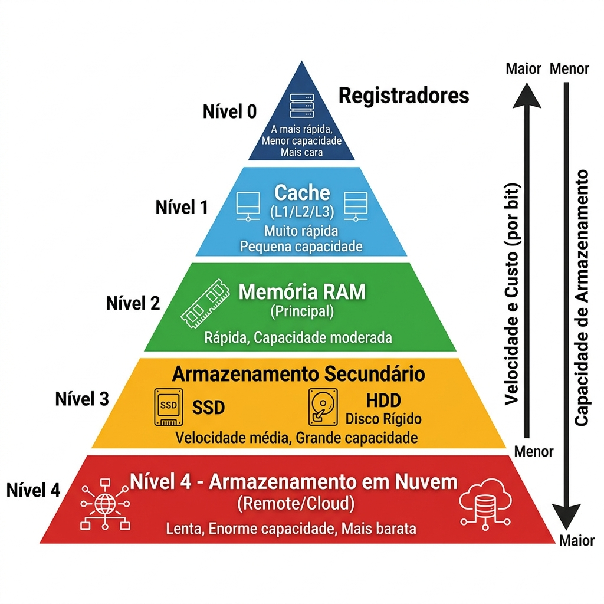
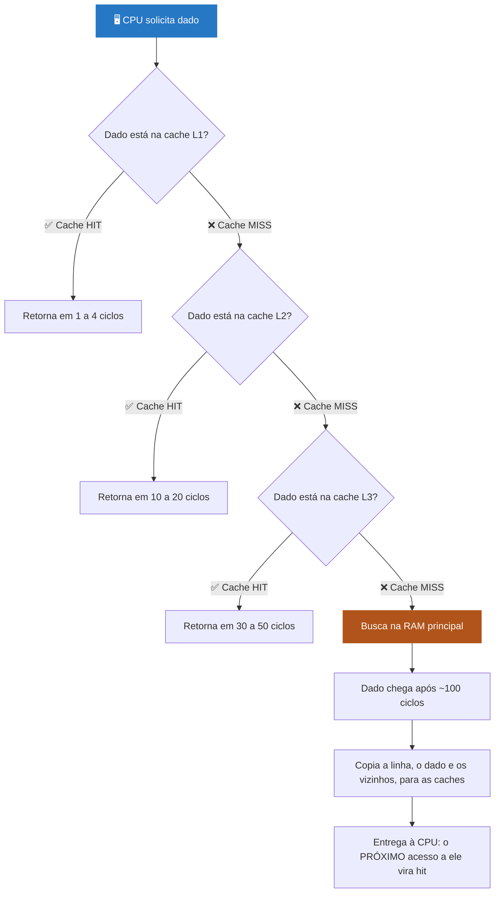
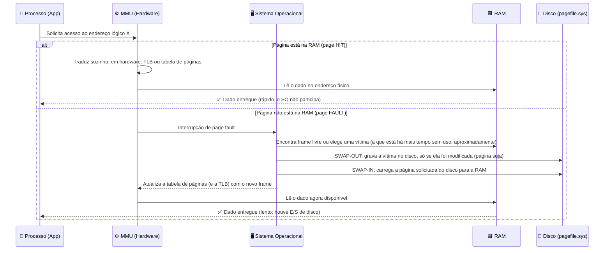

# 🟢 Aula 06 — Hierarquia de Memória e Memória Virtual

**Disciplina:** 90388 — Arquitetura e Organização de Computadores · Sistemas de Informação — Uniube 
**Professor:** Romualdo Mathias Filho 
**Semana:** 6 · `[CONFIRMAR data]` · sala `[CONFIRMAR]` · 📘 Teórica (75 min) 
**Tópicos:** Revisão de MAR e MBR · Hierarquia de memória · Cache L1/L2/L3 · Memória virtual e paginação 
**Página de referência:** [Plano de Ensino e Contrato](./Plano-de-Ensino-e-Contrato)

---

### Como os 75 minutos se dividem hoje

| Momento | Minutos |
|---|---|
| Entrada e caminho até aqui | 0–8 |
| Revisão: MAR e MBR, leitura e escrita | 8–21 |
| A pirâmide: registrador, cache, RAM, SSD | 21–29 |
| A cache e o custo de um miss | 29–40 |
| Memória virtual, paginação e thrashing | 40–53 |
| Slot: diagnóstico em duplas | 53–65 |
| Resumo, reflexão e próxima aula | 65–70 |
| Folga | 70–75 |

---

<b>Nosso caminho até aqui</b>

Responda **antes** de abrir. Se errar, você acabou de descobrir o que revisar hoje.

Na prática da Aula 05, depois do primeiro passo da execução de <code>LOAD R1, 500</code>, o que estava no MAR: 101, 500, ou o conteúdo da posição 500?

**500.** O MAR guarda sempre um **endereço**, nunca um dado. Na busca ele recebeu o endereço do PC (100); na execução recebeu o endereço que veio **dentro da instrução** (500). Se você hesitou aqui, o bloco 1 de hoje é para você.

No subciclo de busca, o endereço do PC vai para o MAR e a RAM devolve a instrução pelo MBR. Quem fica esperando enquanto a RAM responde?

**A CPU inteira.** Nada avança até o MBR receber a instrução. Quanto tempo dura essa espera é a pergunta de hoje.

Na Aula 04, quais dos 5 estágios do pipeline tocam a memória?

**IF** (busca da instrução) e **MEM** (leitura ou gravação de dados, só em `LOAD`/`STORE`). Toda instrução passa pelo IF, então toda instrução depende da memória pelo menos uma vez. Se a memória demora, o pipeline inteiro para. É o problema que a aula de hoje ataca.

> [!INFO] 🎯 O que você leva desta aula
> - Dizer o que o **MAR** e o **MBR** guardam em cada momento, numa leitura e numa escrita, sem trocar os dois.
> - Por que a memória é uma **pirâmide** de tecnologias, e o que muda em velocidade, capacidade e custo a cada degrau.
> - O que a **cache** faz entre a CPU e a RAM, quanto custa um **cache miss** e por que existem três níveis em vez de um.
> - Como a **memória virtual** e a **paginação** deixam um programa usar mais memória do que a RAM tem.
> - Como reconhecer **thrashing** numa máquina lenta com CPU ociosa e disco em 100 %.
>
> **📂 Recursos**
> - [Plano de Ensino e Contrato](./Plano-de-Ensino-e-Contrato) — calendário, notas, prazos e regras
> - **Gerenciador de Tarefas** (Windows, aba Desempenho → Memória) ou `free -h` (Linux) — para ver a RAM e o swap da sua própria máquina durante a aula

<aside class="au-antes">
<b class="au-nota-t">Antes de começar</b>

**Barramento** — o conjunto de fios que liga a CPU à memória. O **barramento de endereço** leva o "onde"; o **barramento de dados** leva o "o quê"; o **barramento de controle** leva a ordem (ler ou gravar). São fios diferentes.

**Latência** — o tempo entre pedir um dado e recebê-lo. Aqui medida em **ciclos de clock**, o "tique" do relógio da CPU.

**SRAM e DRAM** — duas formas de construir memória. A **SRAM** (estática) usa 6 transistores por bit e é rápida; a **DRAM** (dinâmica) usa 1 transistor e 1 capacitor por bit e é barata. A cache é SRAM; a RAM é DRAM.

**Cache hit / cache miss** — hit: o dado estava na cache. Miss: não estava, e a CPU vai buscá-lo num nível mais lento.

**Localidade** — a tendência de um programa reusar o mesmo dado (temporal) e dados vizinhos (espacial). É o que faz a cache valer a pena.

**Volátil** — memória que perde tudo quando a energia acaba. RAM e cache são voláteis; SSD e HD não.

**MMU** — *Memory Management Unit*, o circuito da CPU que traduz endereço lógico (o que o programa usa) em endereço físico (onde o dado está na RAM).

**TLB** — *Translation Lookaside Buffer*, a pequena cache de traduções dentro da MMU. Guarda os últimos pares lógico → físico para não consultar a tabela de páginas na RAM a cada acesso.

**Página** — bloco de tamanho fixo (tipicamente 4 KB) em que a memória virtual é dividida. **Page fault** é o acesso a uma página que não está na RAM.

**Frame** — o espaço de uma página na RAM física. A tabela de páginas diz qual página ocupa qual frame.

**Conjunto de trabalho** — as páginas que um processo está usando de fato num dado momento. Se não cabe na RAM, o processo vive de page fault.

**Swap** — mover páginas entre RAM e disco: *swap-out* tira da RAM, *swap-in* traz de volta. No Windows, o swap fica no arquivo de paginação, o `pagefile.sys`.

**Processo bloqueado** — programa parado esperando algo, como o disco. Enquanto ele espera, o SO põe outro programa para rodar na CPU (isso é **escalonar**).

**Thrashing** — o estado em que o sistema só faz swap e não avança. É o diagnóstico do fim da aula.

</aside>

---

## 1. MAR guarda ONDE, MBR guarda O QUÊ, e na leitura um espera o outro [Revisão ⏳ 13 min]

Na Aula 05 os dois apareceram juntos, no meio do ciclo, e é fácil trocá-los. Hoje eles vêm primeiro e separados, porque a aula inteira de hoje é sobre **quanto a CPU espera** depois que o MAR faz um pedido.

Antes de abrir: a instrução <code>STORE R1, 600</code> grava na posição 600 o valor que está em R1, que é 42. No instante da gravação, o que está no MAR e o que está no MBR?

**MAR = 600 e MBR = 42.** O MAR recebe o **endereço** (para onde o dado vai); o MBR recebe o **dado** (o que vai ser gravado), copiado de R1. Repare que o MBR não serve só para *receber* da memória: na escrita é ele que **entrega** o dado a ela.

| | **MAR** · *Memory **Address** Register* | **MBR** · *Memory **Buffer** Register* |
|---|---|---|
| **Guarda** | um **endereço**: *onde* na memória | um **dado** ou uma instrução: *o quê* |
| **Por que esse nome** | *address* = endereço | *buffer* = área de espera: é onde o dado fica parado entre a CPU e a memória |
| **Fio que usa** | barramento de **endereço**, só de ida (CPU → memória) | barramento de **dados**, nos dois sentidos |
| **Na leitura** | recebe o endereço a ler | recebe o conteúdo que a memória devolve |
| **Na escrita** | recebe o endereço a gravar | recebe o dado a gravar e o entrega à memória |
| **Analogia** | o endereço escrito no envelope | a carta dentro do envelope |

E como a memória sabe se é para ler ou para gravar? Pelo terceiro fio: a UC manda o sinal de **leitura** ou de **escrita** pelo **barramento de controle**.

Selecione **LEITURA** ou **ESCRITA** para isolar o caminho de cada uma. O MAR faz sempre o mesmo trabalho; quem muda de sentido é o MBR.

<figure class="au-fig au-switch" role="group" aria-label="Seletor de leitura e escrita na memória">
<input type="radio" name="a06rw" id="a06-ambas" checked>
<input type="radio" name="a06rw" id="a06-ler">
<input type="radio" name="a06rw" id="a06-escr">

<label for="a06-ambas">AS DUAS</label>
<label for="a06-ler">LEITURA</label>
<label for="a06-escr">ESCRITA</label>

<svg class="au-camadas" viewBox="0 0 520 270" role="img" aria-label="CPU com MAR e MBR ligada à memória. O MAR envia o endereço pelo barramento de endereço, só de ida. Na leitura, o MAR aponta a posição 500 e o dado 42 volta da memória para o MBR. Na escrita, o MAR aponta a posição 600 e o dado 42 sai do MBR para ser gravado ali.">
<defs>
<marker id="a06-seta-az" viewBox="0 0 10 10" refX="9" refY="5" markerWidth="7" markerHeight="7" orient="auto"><path d="M0,0 L10,5 L0,10 z" fill="#2778c4"/></marker>
<marker id="a06-seta-vd" viewBox="0 0 10 10" refX="9" refY="5" markerWidth="7" markerHeight="7" orient="auto"><path d="M0,0 L10,5 L0,10 z" fill="#00aa9f"/></marker>
<marker id="a06-seta-lj" viewBox="0 0 10 10" refX="9" refY="5" markerWidth="7" markerHeight="7" orient="auto"><path d="M0,0 L10,5 L0,10 z" fill="#b1541b"/></marker>
</defs>
<rect x="20" y="20" width="190" height="190" rx="8" fill="none" stroke="#8a8f98" stroke-width="2"></rect>
<text x="115" y="14" text-anchor="middle" font-size="13" style="fill:#8a8f98" font-family="sans-serif" font-weight="bold">CPU</text>
<rect x="50" y="50" width="130" height="44" rx="6" fill="none" stroke="#2778c4" stroke-width="2"></rect>
<text x="115" y="70" text-anchor="middle" font-size="14" style="fill:#2778c4" font-family="monospace" font-weight="bold">MAR</text>
<text x="115" y="86" text-anchor="middle" font-size="11" style="fill:#2778c4" font-family="sans-serif">endereço (onde)</text>
<rect x="50" y="140" width="130" height="44" rx="6" fill="none" stroke="#2778c4" stroke-width="2"></rect>
<text x="115" y="160" text-anchor="middle" font-size="14" style="fill:#2778c4" font-family="monospace" font-weight="bold">MBR</text>
<text x="115" y="176" text-anchor="middle" font-size="11" style="fill:#2778c4" font-family="sans-serif">dado (o quê)</text>
<rect x="360" y="20" width="140" height="190" rx="8" fill="none" stroke="#8a8f98" stroke-width="2"></rect>
<text x="430" y="14" text-anchor="middle" font-size="13" style="fill:#8a8f98" font-family="sans-serif" font-weight="bold">MEMÓRIA</text>
<rect x="375" y="60" width="110" height="30" rx="4" fill="none" stroke="#8a8f98" stroke-width="1.5"></rect>
<text x="430" y="80" text-anchor="middle" font-size="12" style="fill:#8a8f98" font-family="monospace">[500] = 42</text>
<rect x="375" y="140" width="110" height="30" rx="4" fill="none" stroke="#8a8f98" stroke-width="1.5"></rect>
<text x="430" y="160" text-anchor="middle" font-size="12" style="fill:#8a8f98" font-family="monospace">[600] = ?</text>
<text x="270" y="40" text-anchor="middle" font-size="11" style="fill:#2778c4" font-family="sans-serif">barramento de endereço (só ida)</text>
<g class="c1">
<line x1="180" y1="66" x2="373" y2="72" stroke="#2778c4" stroke-width="2" marker-end="url(#a06-seta-az)"></line>
<text x="250" y="58" text-anchor="middle" font-size="11" style="fill:#2778c4" font-family="monospace">500</text>
<line x1="373" y1="85" x2="182" y2="150" stroke="#00aa9f" stroke-width="2.5" marker-end="url(#a06-seta-vd)"></line>
<text x="260" y="234" text-anchor="middle" font-size="12" style="fill:#00aa9f" font-family="monospace">LEITURA, o dado VEM: LOAD R1,500 → MBR=42 → R1</text>
</g>
<g class="c2">
<line x1="180" y1="80" x2="373" y2="150" stroke="#2778c4" stroke-width="2" stroke-dasharray="5 3" marker-end="url(#a06-seta-az)"></line>
<text x="240" y="120" text-anchor="middle" font-size="11" style="fill:#2778c4" font-family="monospace">600</text>
<line x1="182" y1="174" x2="373" y2="162" stroke="#b1541b" stroke-width="2.5" marker-end="url(#a06-seta-lj)"></line>
<text x="260" y="258" text-anchor="middle" font-size="12" style="fill:#b1541b" font-family="monospace">ESCRITA, o dado VAI: STORE R1,600 → [600]=42</text>
</g>
</svg>
<figcaption class="au-legenda">O MAR (azul) faz sempre o mesmo trabalho: manda um endereço, só de ida. Quem muda de sentido é o MBR. Na <b>leitura</b> (verde) o MAR aponta a posição 500 e o dado vem da memória para o MBR; na <b>escrita</b> (laranja) o MAR aponta a posição 600 e o dado sai do MBR para a memória. Fonte: elaborado pelo professor com base em STALLINGS (2024, cap. 3, página [CONFIRMAR]).</figcaption>
</figure>

### 1.1 O que faltava era o QUANDO: na leitura, o MBR só muda depois que a memória responde

"Onde" e "o quê" são a regra. O que faz errar é o **momento**. A CPU faz o ciclo em passos, as **micro-operações** (t1, t2, t3): cada tN é um tique do clock, e em cada um só um ou dois registradores mudam. A seta `←` lê-se "recebe", e a contagem t1, t2, t3 **recomeça em cada fase**.

Antes de abrir: no passo t1 da execução de <code>LOAD R1, 500</code>, o MAR acaba de receber 500. O que está no MBR nesse instante?

**Ainda `LOAD R1, 500`, a instrução que sobrou da busca.** Em t1 o pedido acabou de sair pelo MAR. O conteúdo de `[500]` só chega ao MBR ao fim de t2. Se você respondeu "42", juntou dois passos num só, e é exatamente esse atalho que embaralha MAR e MBR.

| Fase | Passo | Micro-operação | MAR | MBR | O que mudou |
|---|---|---|---|---|---|
| **Busca** (PC = 100) | t1 | `MAR ← PC` | **100** | (anterior) | o endereço sai do **PC** |
| | t2 | `MBR ← memória` · `PC ← PC + 1` | 100 | **`LOAD R1, 500`** | a memória respondeu |
| | t3 | `IR ← MBR` | 100 | `LOAD R1, 500` | a instrução vai para o IR |
| **Execução** do `LOAD R1, 500` | t1 | `MAR ← IR(endereço)` | **500** | `LOAD R1, 500` | o endereço sai **de dentro da instrução** |
| | t2 | `MBR ← memória` | 500 | **42** | a memória respondeu |
| | t3 | `R1 ← MBR` | 500 | 42 | o dado vai para R1 |
| **Execução** do `STORE R1, 600` | t1 | `MAR ← IR(endereço)` | **600** | `STORE R1, 600` | o endereço sai de dentro da instrução |
| | t2 | `MBR ← R1` | 600 | **42** | o dado sai de R1 |
| | t3 | `memória ← MBR` | 600 | 42 | a memória grava 42 em `[600]` |

> [!WARNING] ⚠️ Correção da Aula 05
> Os valores do gabarito da prática da Aula 05 estavam certos; os rótulos das linhas, não. A linha "meio do fetch" juntou dois passos (t1 e t2 da busca). A linha "início da execução" mostrava o MBR já com o conteúdo de `[500]`, que é o estado do **fim de t2**, não do início. A tabela acima separa passo a passo, e é ela que vale. O PC também: aqui ele soma 1 já em t2, junto com a leitura, como no STALLINGS; na Aula 05 ele só somava no fim da busca. Nas duas ordens o PC aponta a próxima instrução antes de a execução começar.

Leia a coluna do MAR de cima para baixo: ele recebe do **PC** só na busca; na execução recebe do **campo de endereço da instrução**. 

Agora leia a do MBR na leitura: ele só muda no passo **seguinte** ao do MAR, porque primeiro vai o pedido, depois vem a resposta. Na escrita, entre t1 e t2 não há resposta a esperar (o `MBR ← R1` é interno), e os dois poderiam ser um passo só; a espera pela memória fica no t3.

Sua vez, no caderno: <code>STORE R2, 700</code>, com R2 = 9. Escreva t1, t2 e t3 da execução, com o valor do MAR e do MBR em cada passo.

t1: `MAR ← IR(endereço)` → MAR = **700**, MBR = `STORE R2, 700` (sobrou da busca). t2: `MBR ← R2` → MAR = 700, MBR = **9**. t3: `memória ← MBR` → a posição `[700]` passa a valer 9. O 9 nunca passa pelo MAR.

> [!NOTE] 💬 Outros nomes para os mesmos dois
> Em material em português o MAR também aparece como **REM** (Registrador de Endereço de Memória) e o MBR como **RDM** (Registrador de Dados da Memória); no PATTERSON e HENNESSY, o MBR aparece como **MDR** (*Memory Data Register*). `[CONFIRMAR: página de cada nomenclatura]` Mudou o nome, não mudou o papel: um guarda onde, o outro guarda o quê.

**A pergunta que fica para o resto da aula:** o `LOAD` que você acabou de traçar em t1, t2 e t3 leva 3 ciclos?

---

## 2. A hierarquia de memória finge que existe uma memória rápida como o registrador e grande como o disco [Teoria ⏳ 8 min]

O processador da Aula 05 lê registrador a cada ciclo. Se toda leitura fosse na RAM, ele passaria a maior parte do tempo esperando.

Antes de abrir: trocaram o SSD SATA por um NVMe. O boot ficou bem mais rápido, mas a planilha gigante já aberta no Excel continua igual de lenta. Por quê?

**Porque a planilha aberta não está no disco.** O disco só participou na abertura; depois disso ela vive na RAM e na cache, e o disco não participa mais. Trocar o degrau errado da pirâmide não muda nada. É essa pirâmide que vem a seguir.

A **hierarquia de memória** resolve isso empilhando tecnologias diferentes: cada nível é menor, mais rápido e mais caro por byte que o de baixo. O objetivo é criar, para a CPU, a ilusão de uma memória com a **velocidade dos registradores** e a capacidade e o custo do armazenamento em massa.

<figure class="au-fig">

<figcaption class="au-legenda">No topo, memórias menores, mais rápidas e mais caras (registradores, cache). Na base, maiores, mais lentas e mais baratas (SSD/HD, nuvem). Fonte: elaborado pelo professor com base em STALLINGS (2024, cap. 4, página [CONFIRMAR]), adaptado: o nível da nuvem não está no livro.</figcaption>
</figure>

> [!TIP] 💡 Dica de produção — a pirâmide é o seu escritório
> Pense na hierarquia como a organização física de uma sala de engenharia:
> - **Registradores** → o que você está lendo ou segurando nas mãos neste exato segundo.
> - **Cache L1/L2/L3** → os documentos abertos na sua mesa: acesso imediato, sem sair da cadeira.
> - **RAM** → o armário no canto da sala: bastante espaço, mas exige levantar e caminhar.
> - **SSD/HD** → o arquivo morto no porão do prédio: cabe tudo, e o acesso demora.
> - **Nuvem** → o galpão terceirizado em outra cidade: capacidade quase infinita, mas exige transporte (latência de rede).

A **RAM** (*Random Access Memory*, memória de acesso aleatório) é feita de **DRAM**: mais lenta que a SRAM da cache, mas viável em gigabytes. É **volátil**: desligou, perdeu tudo.

Tudo que está "aberto e em execução" no seu computador vive na RAM: o navegador com 50 abas, o Spotify, o VS Code, o jogo, o Discord. Quando a RAM esgota, o sistema operacional precisa de um plano B, e ele é o tópico 4.

A memória secundária é **não volátil**: os dados sobrevivem ao desligamento. Os SSDs NVMe revolucionaram essa camada com latências em microssegundos, mas continuam **estruturalmente 1000x mais lentos** que a RAM no acesso aleatório.

---

## 3. A cache existe porque a CPU não pode esperar 100 ciclos a cada acesso à RAM [Teoria ⏳ 11 min]

Antes de abrir: o <code>LOAD R1, 500</code> do bloco 1 executa em t1, t2 e t3, e cada tN é um tique do clock. Então a execução leva 3 ciclos?

**Só se a memória responder num tique, e isso quase nunca acontece. Mas quase sempre são poucos ciclos, porque a L1 acerta a maioria dos acessos.** Em t2 a UC pede `MBR ← memória` e fica parada, em **estados de espera**, até o dado chegar ao MBR. Quanto tempo depende de **quem** responde ao MAR:

| Onde está `[500]` | Ciclos parados em t2 (ordem de grandeza) |
|---|---|
| L1 | ~4 |
| L3 | ~40 |
| só na RAM | ~100 |

A tabela de latências, logo depois da figura do chip, é a resposta inteira.

Quando o MAR pede um endereço, quem responde primeiro não é a RAM: é a **cache**. Ela é o segredo de desempenho dos processadores modernos. Fica entre a CPU ultrarrápida e a RAM relativamente lenta, guardando cópias dos dados que a CPU usa com mais frequência. É feita de SRAM, por isso é rápida; é pequena, por isso é viável.

<figure class="au-fig">
<svg viewBox="0 0 700 300" role="img" aria-label="Chip com quatro núcleos. Cada núcleo tem L1 de instruções, L1 de dados e L2 privadas. Abaixo, dentro do mesmo chip, a L3 compartilhada por todos os núcleos. Fora do chip, a RAM, ligada à L3." font-family="sans-serif" font-size="13">
<rect x="20" y="30" width="520" height="250" rx="10" fill="none" stroke="#8a8f98" stroke-width="2"/>
<text x="280" y="22" text-anchor="middle" fill="#8a8f98" font-weight="bold">Chip do processador</text>
<rect x="35" y="52" width="115" height="128" rx="6" fill="none" stroke="#2778c4" stroke-width="2"/>
<text x="92" y="72" text-anchor="middle" fill="#2778c4" font-weight="bold">Núcleo 0</text>
<rect x="43" y="84" width="47" height="30" rx="4" fill="none" stroke="#2778c4" stroke-width="1.5"/><text x="66" y="104" text-anchor="middle" fill="#2778c4" font-size="11">L1-I</text>
<rect x="95" y="84" width="47" height="30" rx="4" fill="none" stroke="#2778c4" stroke-width="1.5"/><text x="118" y="104" text-anchor="middle" fill="#2778c4" font-size="11">L1-D</text>
<rect x="43" y="124" width="99" height="40" rx="4" fill="none" stroke="#2778c4" stroke-width="1.5"/><text x="92" y="149" text-anchor="middle" fill="#2778c4" font-size="12">L2</text>
<line x1="92" y1="180" x2="92" y2="198" stroke="#8a8f98" stroke-width="1.5"/>
<rect x="162" y="52" width="115" height="128" rx="6" fill="none" stroke="#2778c4" stroke-width="2"/>
<text x="219" y="72" text-anchor="middle" fill="#2778c4" font-weight="bold">Núcleo 1</text>
<rect x="170" y="84" width="47" height="30" rx="4" fill="none" stroke="#2778c4" stroke-width="1.5"/><text x="193" y="104" text-anchor="middle" fill="#2778c4" font-size="11">L1-I</text>
<rect x="222" y="84" width="47" height="30" rx="4" fill="none" stroke="#2778c4" stroke-width="1.5"/><text x="245" y="104" text-anchor="middle" fill="#2778c4" font-size="11">L1-D</text>
<rect x="170" y="124" width="99" height="40" rx="4" fill="none" stroke="#2778c4" stroke-width="1.5"/><text x="219" y="149" text-anchor="middle" fill="#2778c4" font-size="12">L2</text>
<line x1="219" y1="180" x2="219" y2="198" stroke="#8a8f98" stroke-width="1.5"/>
<rect x="289" y="52" width="115" height="128" rx="6" fill="none" stroke="#2778c4" stroke-width="2"/>
<text x="346" y="72" text-anchor="middle" fill="#2778c4" font-weight="bold">Núcleo 2</text>
<rect x="297" y="84" width="47" height="30" rx="4" fill="none" stroke="#2778c4" stroke-width="1.5"/><text x="320" y="104" text-anchor="middle" fill="#2778c4" font-size="11">L1-I</text>
<rect x="349" y="84" width="47" height="30" rx="4" fill="none" stroke="#2778c4" stroke-width="1.5"/><text x="372" y="104" text-anchor="middle" fill="#2778c4" font-size="11">L1-D</text>
<rect x="297" y="124" width="99" height="40" rx="4" fill="none" stroke="#2778c4" stroke-width="1.5"/><text x="346" y="149" text-anchor="middle" fill="#2778c4" font-size="12">L2</text>
<line x1="346" y1="180" x2="346" y2="198" stroke="#8a8f98" stroke-width="1.5"/>
<rect x="416" y="52" width="115" height="128" rx="6" fill="none" stroke="#2778c4" stroke-width="2"/>
<text x="473" y="72" text-anchor="middle" fill="#2778c4" font-weight="bold">Núcleo 3</text>
<rect x="424" y="84" width="47" height="30" rx="4" fill="none" stroke="#2778c4" stroke-width="1.5"/><text x="447" y="104" text-anchor="middle" fill="#2778c4" font-size="11">L1-I</text>
<rect x="476" y="84" width="47" height="30" rx="4" fill="none" stroke="#2778c4" stroke-width="1.5"/><text x="499" y="104" text-anchor="middle" fill="#2778c4" font-size="11">L1-D</text>
<rect x="424" y="124" width="99" height="40" rx="4" fill="none" stroke="#2778c4" stroke-width="1.5"/><text x="473" y="149" text-anchor="middle" fill="#2778c4" font-size="12">L2</text>
<line x1="473" y1="180" x2="473" y2="198" stroke="#8a8f98" stroke-width="1.5"/>
<rect x="35" y="198" width="495" height="62" rx="6" fill="none" stroke="#00aa9f" stroke-width="2"/>
<text x="282" y="226" text-anchor="middle" fill="#00aa9f" font-weight="bold">L3, compartilhada por todos os núcleos</text>
<text x="282" y="246" text-anchor="middle" fill="#00aa9f" font-size="11">dentro do chip, mais longe de cada núcleo que a L2</text>
<rect x="585" y="110" width="100" height="90" rx="6" fill="none" stroke="#b1541b" stroke-width="2"/>
<text x="635" y="150" text-anchor="middle" fill="#b1541b" font-weight="bold">RAM</text>
<text x="635" y="170" text-anchor="middle" fill="#b1541b" font-size="11">fora do chip</text>
<line x1="530" y1="229" x2="585" y2="170" stroke="#8a8f98" stroke-width="1.5"/>
</svg>
<figcaption class="au-legenda">L1 (separada em instruções e dados) e L2 são privadas de cada núcleo; a L3 fica no mesmo chip e é compartilhada por todos; a RAM fica fora do chip. Tamanhos e latências de cada nível estão na tabela abaixo. Fonte: elaborado pelo professor com base em STALLINGS (2024, cap. 4, página [CONFIRMAR]).</figcaption>
</figure>

| Nível | Tamanho típico | Latência | Quem compartilha |
|---|---|---|---|
| **Registradores** | Bytes (dezenas) | ~1 ciclo de clock | Apenas o núcleo em uso |
| **Cache L1** | 32–64 KB | 1–4 ciclos | Privada por núcleo, separada em instruções (I-Cache) e dados (D-Cache), para o IF e o MEM do pipeline lerem no mesmo ciclo |
| **Cache L2** | 256 KB – 1 MB | 10–20 ciclos | Privada por núcleo |
| **Cache L3** | 8 – 64 MB | 30–50 ciclos | **Compartilhada** entre todos os núcleos |
| **RAM (DRAM)** | 8 – 128 GB | ~100 ciclos | Todos os processos do sistema |
| **SSD NVMe** | 500 GB – 4 TB | ~100.000 ciclos | Todos os usuários e o SO |

Antes de abrir: por que os processadores têm L1, L2 e L3 em vez de uma única cache L1 gigante de 32 MB?

**Por limitação física.** Cache maior exige circuitos de decodificação de endereço mais complexos e distâncias maiores dentro do chip, e isso aumenta a latência de acesso. A saída é ter níveis pequenos e muito rápidos junto de cada núcleo (L1/L2) e um nível maior compartilhado (L3). Assim a arquitetura ganha velocidade para o dado imediato e capacidade para a comunicação entre núcleos.

> [!WARNING] ⚠️ Gotcha — a penalidade do cache miss
> Cada nível que não tem o dado é um **cache miss** naquele nível. Quando falham os três (L1, L2 e L3), o processador suspende a execução (*stall*) e vai buscar o dado na RAM: **~100 ciclos** gastos em espera, sem executar nada útil. Um hit na L1 responde em 1 a 4 ciclos; a RAM, em ~100: uma diferença de **25 a 100 vezes**.

> [!TIP] 💡 Dica de produção — código que a cache gosta
> Desenvolvedores experientes organizam os loops de dados para garantir **localidade espacial e temporal**: arrays contíguos na memória em vez de estruturas dispersas, como listas encadeadas. Ao buscar um dado na RAM, a CPU traz o bloco vizinho inteiro (a **linha de cache**); percorrer o array em sequência transforma um miss em vários hits (com linha de 64 bytes e inteiros de 4 bytes: 1 miss e 15 hits).

### 3.1 A busca desce nível a nível, e cada miss custa mais que o anterior

A prioridade é sempre a memória mais rápida. Quando os misses se encadeiam, a CPU fica em *stall*, consumindo ciclos sem executar instruções úteis. E repare no último passo: o dado que veio da RAM é **copiado para as caches**, porque a aposta é que ele será usado de novo em breve (localidade temporal).

---

## 4. A memória virtual dá a cada processo a RAM inteira, e cobra em page faults [Teoria ⏳ 13 min]

Antes de abrir: você abre o Chrome com 50 abas, o Photoshop, o VS Code e um jogo, e a RAM de 8 GB esgota. O sistema trava, fecha um programa, ou continua?

**Em geral, continua, mais lento.** (No Linux, se nem o swap der conta, o kernel encerra um processo para liberar memória.) O sistema operacional tira da RAM as páginas que ninguém usou recentemente e as guarda no disco. Os programas não percebem: cada um continua enxergando a "sua" memória inteira. O que muda é o tempo de resposta quando uma dessas páginas é pedida de volta.

A **memória virtual** é uma técnica gerenciada em conjunto pela **MMU** do processador e pelo **sistema operacional**. Ela "engana" os aplicativos: cada processo acredita ter toda a memória do sistema para si, enquanto na prática os dados ficam distribuídos entre a RAM e o disco.

<figure class="au-fig">
<svg viewBox="0 0 760 350" role="img" aria-label="Paginação: um processo com páginas 0 a 3, a tabela de páginas com bit presente e número do frame, a RAM com frames 0 a 4 e a página 2 no disco" font-family="sans-serif" font-size="13">
<defs>
<marker id="pg-seta" viewBox="0 0 10 10" refX="9" refY="5" markerWidth="7" markerHeight="7" orient="auto"><path d="M0,0 L10,5 L0,10 z" fill="#8a8f98"/></marker>
<marker id="pg-seta-d" viewBox="0 0 10 10" refX="9" refY="5" markerWidth="7" markerHeight="7" orient="auto"><path d="M0,0 L10,5 L0,10 z" fill="#b1541b"/></marker>
</defs>
<rect x="20" y="40" width="150" height="230" rx="8" fill="none" stroke="#2778c4" stroke-width="2"/>
<text x="95" y="30" text-anchor="middle" fill="#2778c4" font-weight="bold">Processo</text>
<text x="95" y="62" text-anchor="middle" fill="#2778c4" font-size="11">endereço lógico</text>
<rect x="40" y="80" width="110" height="36" rx="5" fill="none" stroke="#2778c4" stroke-width="2"/><text x="95" y="103" text-anchor="middle" fill="#2778c4">Página 0</text>
<rect x="40" y="126" width="110" height="36" rx="5" fill="none" stroke="#2778c4" stroke-width="2"/><text x="95" y="149" text-anchor="middle" fill="#2778c4">Página 1</text>
<rect x="40" y="172" width="110" height="36" rx="5" fill="none" stroke="#b1541b" stroke-width="3"/><text x="95" y="195" text-anchor="middle" fill="#b1541b" font-weight="bold">Página 2</text>
<rect x="40" y="218" width="110" height="36" rx="5" fill="none" stroke="#2778c4" stroke-width="2"/><text x="95" y="241" text-anchor="middle" fill="#2778c4">Página 3</text>
<rect x="230" y="40" width="230" height="230" rx="8" fill="none" stroke="#8a8f98" stroke-width="2"/>
<text x="345" y="30" text-anchor="middle" fill="#8a8f98" font-weight="bold">Tabela de páginas</text>
<text x="270" y="66" text-anchor="middle" fill="#8a8f98" font-size="11">Página</text>
<text x="345" y="66" text-anchor="middle" fill="#8a8f98" font-size="11">Presente?</text>
<text x="420" y="66" text-anchor="middle" fill="#8a8f98" font-size="11">Frame</text>
<line x1="240" y1="72" x2="450" y2="72" stroke="#8a8f98" stroke-width="1"/>
<text x="270" y="103" text-anchor="middle" fill="#8a8f98">0</text><text x="345" y="103" text-anchor="middle" fill="#00aa9f" font-weight="bold">1</text><text x="420" y="103" text-anchor="middle" fill="#00aa9f">2</text>
<text x="270" y="149" text-anchor="middle" fill="#8a8f98">1</text><text x="345" y="149" text-anchor="middle" fill="#00aa9f" font-weight="bold">1</text><text x="420" y="149" text-anchor="middle" fill="#00aa9f">0</text>
<text x="270" y="195" text-anchor="middle" fill="#8a8f98">2</text><text x="345" y="195" text-anchor="middle" fill="#b1541b" font-weight="bold">0</text><text x="420" y="195" text-anchor="middle" fill="#b1541b">disco</text>
<text x="270" y="241" text-anchor="middle" fill="#8a8f98">3</text><text x="345" y="241" text-anchor="middle" fill="#00aa9f" font-weight="bold">1</text><text x="420" y="241" text-anchor="middle" fill="#00aa9f">4</text>
<line x1="150" y1="98" x2="228" y2="98" stroke="#8a8f98" stroke-width="1.5" marker-end="url(#pg-seta)"/>
<line x1="150" y1="144" x2="228" y2="144" stroke="#8a8f98" stroke-width="1.5" marker-end="url(#pg-seta)"/>
<line x1="150" y1="190" x2="228" y2="190" stroke="#8a8f98" stroke-width="1.5" marker-end="url(#pg-seta)"/>
<line x1="150" y1="236" x2="228" y2="236" stroke="#8a8f98" stroke-width="1.5" marker-end="url(#pg-seta)"/>
<rect x="540" y="40" width="200" height="238" rx="8" fill="none" stroke="#00aa9f" stroke-width="2"/>
<text x="640" y="30" text-anchor="middle" fill="#00aa9f" font-weight="bold">RAM</text>
<text x="640" y="62" text-anchor="middle" fill="#00aa9f" font-size="11">endereço físico</text>
<rect x="555" y="70" width="170" height="34" rx="5" fill="none" stroke="#00aa9f" stroke-width="2"/><text x="640" y="92" text-anchor="middle" fill="#00aa9f">Frame 0 · Página 1</text>
<rect x="555" y="112" width="170" height="34" rx="5" fill="none" stroke="#8a8f98" stroke-width="1.5" stroke-dasharray="4 3"/><text x="640" y="134" text-anchor="middle" fill="#8a8f98">Frame 1 · outro processo</text>
<rect x="555" y="154" width="170" height="34" rx="5" fill="none" stroke="#00aa9f" stroke-width="2"/><text x="640" y="176" text-anchor="middle" fill="#00aa9f">Frame 2 · Página 0</text>
<rect x="555" y="196" width="170" height="34" rx="5" fill="none" stroke="#8a8f98" stroke-width="1.5" stroke-dasharray="4 3"/><text x="640" y="218" text-anchor="middle" fill="#8a8f98">Frame 3 · livre</text>
<rect x="555" y="238" width="170" height="34" rx="5" fill="none" stroke="#00aa9f" stroke-width="2"/><text x="640" y="260" text-anchor="middle" fill="#00aa9f">Frame 4 · Página 3</text>
<rect x="555" y="300" width="170" height="36" rx="5" fill="none" stroke="#b1541b" stroke-width="2"/><text x="640" y="323" text-anchor="middle" fill="#b1541b" font-weight="bold">Disco (swap) · Página 2</text>
<line x1="462" y1="98" x2="553" y2="171" stroke="#8a8f98" stroke-width="1.5" marker-end="url(#pg-seta)"/>
<line x1="462" y1="144" x2="553" y2="87" stroke="#8a8f98" stroke-width="1.5" marker-end="url(#pg-seta)"/>
<line x1="462" y1="236" x2="553" y2="255" stroke="#8a8f98" stroke-width="1.5" marker-end="url(#pg-seta)"/>
<line x1="462" y1="190" x2="553" y2="318" stroke="#b1541b" stroke-width="2" stroke-dasharray="6 4" marker-end="url(#pg-seta-d)"/>
<text x="500" y="300" text-anchor="middle" fill="#b1541b" font-size="11" font-weight="bold">page fault</text>
</svg>
<figcaption class="au-legenda">O processo enxerga páginas numeradas em sequência (0 a 3); a tabela de páginas diz em qual <b>frame</b> da RAM cada uma está, e o bit <b>presente</b> diz se está. A página 2 está no disco: tocar nela dispara o <b>page fault</b>. Frames 1 e 3 pertencem a outro processo ou estão livres. Fonte: elaborado para a disciplina.</figcaption>
</figure>

### 4.1 A MMU traduz sozinha; só o page fault chama o SO e espera o disco

No acerto, o sistema operacional não entra: a MMU traduz o endereço em hardware. E ela não lê a tabela de páginas na RAM a cada acesso, porque isso ao menos dobraria o custo de toda leitura.

As traduções recentes ficam na **TLB**, a pequena cache dentro da própria MMU. A tabela só é consultada quando a TLB falha.

O **page fault** é uma **exceção**. Ela funciona como a **interrupção** da Aula 05: salva PC e PSW e desvia para uma rotina do SO. A diferença é que acontece **no meio** da instrução, que depois é refeita do começo.

É o evento mais caro da sequência, mas a CPU não fica parada esperando. O SO **bloqueia o processo** que causou o fault e escalona outro para rodar enquanto o disco responde.

O caro é para o processo bloqueado. Ele só volta quando a página chegar, cerca de 100.000 ciclos depois, contra ~100 de um acesso à RAM.

### 4.2 Thrashing é só swap: CPU ociosa, disco em 100 %

> [!WARNING] ⚠️ Gotcha — degradação por thrashing
> O **thrashing** ocorre quando a RAM física está tão escassa que o sistema operacional passa praticamente 100 % do tempo movendo páginas entre o disco e a RAM (swap-out e swap-in). O uso de CPU despenca não porque ela "para", mas porque **todos os processos estão bloqueados esperando E/S** (entrada e saída) de disco ao mesmo tempo: o SO não tem ninguém pronto para escalonar, e o disco trava em 100 % de uso.
>
> Em servidor de nuvem, o thrashing derruba o serviço inteiro antes de qualquer alarme de CPU disparar; a saída imediata é mais RAM ou um limite rígido de memória por processo.

| Situação | Causa | Solução |
|---|---|---|
| Máquina lenta, disco em 100 % | RAM esgotada → thrashing | Adicionar RAM ou fechar processos |
| "Arquivo de paginação cheio" | `pagefile.sys` pequeno demais | Ampliar o arquivo de paginação |
| Processo com page fault constante | Conjunto de trabalho maior que a RAM disponível | Otimizar o uso de memória da aplicação |

> [!TIP] 💡 Dica de produção — veja o swap na sua máquina agora
> No Windows, Gerenciador de Tarefas → Desempenho → Memória: a linha **Comprometida** `[CONFIRMAR: rótulo no Windows em português]` mostra RAM física mais arquivo de paginação. Comprometida acima da RAM instalada é sinal de que o sistema **pode** estar paginando; a confirmação vem do uso de disco subindo junto, ou do Monitor de Recursos (aba Memória), que mostra as falhas de página por processo `[CONFIRMAR: nome da coluna no Windows em português]`. No Linux, `free -h` mostra a linha `Swap`. Se o valor usado de swap cresce enquanto a máquina engasga, você está vendo o tópico 4 acontecer.

---

<b>Interativo</b> · Diagnóstico: em que degrau da pirâmide está o problema? · 12 min, em duplas

Para cada cenário: (1) em que nível da hierarquia está o gargalo? (2) qual conceito da aula explica? (3) o que você faria primeiro?

1. Notebook com 8 GB de RAM, 40 abas do Chrome e o Photoshop aberto. A luz do SSD fica acesa direto e a CPU marca 10 % de uso.
2. Num servidor de banco de dados, a mesma consulta leva 200 ms na primeira vez e 2 ms na segunda, sem nada ter mudado.
3. Um jogo trava por um segundo quando muda de fase e depois flui sem engasgo.
4. Um programa que percorre uma matriz por colunas leva 5 vezes mais tempo do que percorrendo por linhas, com a mesma quantidade de somas.

Discussão (abrir só depois de a dupla decidir)

1. **Nível 2 → 3, thrashing.** RAM esgotada, o SO faz swap sem parar. A CPU marca 10 % porque todos os processos estão bloqueados esperando E/S (entrada e saída) de disco e não há ninguém pronto para rodar. Fechar processos ou adicionar RAM.
2. **Nível 3 → 2.** Na primeira vez os dados vieram do disco; na segunda já estavam na RAM: o SO guarda ali cópias do que leu do disco (o *page cache*, que é RAM, não a cache SRAM do tópico 3). É a hierarquia funcionando a favor.
3. **Nível 3 → 2.** A fase nova é carregada do disco para a RAM; depois disso, tudo vem da RAM e da cache.
4. **Nível 1, cache miss.** Em C a matriz é guardada linha a linha; percorrer por colunas pula endereços e desperdiça a linha de cache (localidade espacial).

<b>Critério de pronto:</b> os quatro cenários com nível, conceito e ação, e a dupla sabe explicar por que a CPU marca 10 % no cenário 1.

<b>Plano B:</b> a atividade não depende de ferramenta nem de rede. Se o projetor cair, os quatro cenários vão no quadro e a discussão segue igual.

---

<b>O que você viu acontecer hoje</b>

Oito coisas passaram na tela nesta aula. Tente responder o *porquê* antes de abrir. É o esforço de lembrar que fixa, não a releitura.

| O que você viu acontecer | |
| :--- | :--- |
| No <code>STORE R1, 600</code>, o MAR ficou com 600 e o MBR com 42, e o dado saiu do MBR para a memória | 

por quê?
O MAR guarda sempre o endereço (onde) e manda só de ida; o MBR guarda o dado (o quê) e anda nos dois sentidos: recebe na leitura, entrega na escrita. E o quando: na leitura, o MBR só muda no passo seguinte ao do MAR, depois que a memória responde. Na busca o MAR recebe do PC; na execução, do campo de endereço da instrução.
 |
| A pirâmide tinha o registrador no topo e a nuvem na base | 

por quê?
Cada degrau para baixo é maior, mais barato por byte e mais lento. A hierarquia empilha tecnologias para a CPU enxergar uma memória rápida como o registrador e grande como o disco.
 |
| A tabela de latências pulou de 4 ciclos (L1) para 100 (RAM) e 100.000 (SSD) | 

por quê?
Tecnologia e distância. SRAM junto do núcleo responde em poucos ciclos; DRAM fora do chip, em ~100; flash, por um barramento de E/S, em ~100.000.
 |
| A DRAM tem 1 transistor e 1 capacitor por bit, e a SRAM tem 6 transistores | 

por quê?
É a troca entre densidade e velocidade. A célula pequena da DRAM cabe em gigabytes mas precisa de refresh; a célula grande da SRAM é rápida e estável, mas cara. Cada uma fica no degrau em que compensa.
 |
| No fluxograma, o dado que veio da RAM foi copiado para as caches | 

por quê?
Localidade temporal: se o dado foi usado agora, a aposta é que será usado de novo em breve. O próximo acesso vira hit em vez de miss.
 |
| L1 e L2 eram privadas de cada núcleo, e a L3 era compartilhada | 

por quê?
Cache maior é mais lenta. Níveis pequenos junto de cada núcleo dão velocidade; um nível grande compartilhado dá capacidade e serve à comunicação entre núcleos.
 |
| Na tabela de páginas, a página 2 tinha o bit presente em 0 e apontava para o disco | 

por quê?
A RAM encheu e o SO fez swap-out dessa página. Se o processo tocar nela, ocorre page fault: o SO elege uma vítima, faz swap-in e só então o processo continua.
 |
| No cenário do notebook, a CPU marcava 10 % e o disco, 100 % | 

por quê?
Thrashing. O SO passa o tempo inteiro trocando páginas entre RAM e disco; todos os processos ficam bloqueados esperando E/S, e a CPU não tem quem escalonar. Aumentar a RAM ou reduzir os processos resolve; um processador mais rápido, não.
 |

<b>Para pensar até a próxima aula</b>

A cache e a memória virtual são duas mentiras contadas à CPU e aos programas: uma finge que a RAM é rápida, a outra finge que a RAM é infinita. As duas dependem de que o programa se comporte de um jeito previsível (localidade).

Que tipo de programa quebra as duas mentiras ao mesmo tempo? E o que sobra de desempenho quando isso acontece?

<b>Referências desta aula</b>

- STALLINGS, W. **Arquitetura e Organização de Computadores: projetando com foco em desempenho.** 11. ed. São Paulo: Pearson, 2024 `[CONFIRMAR: edição e ano conforme o legado]`. cap. 3 (função e interconexão: MAR e MBR), cap. [CONFIRMAR] (operação da unidade de controle: micro-operações t1, t2, t3), cap. 4 (cache), cap. 5 (memória interna) e cap. 8 (suporte ao SO), páginas [CONFIRMAR] — MAR e MBR na leitura e na escrita, e o traço de micro-operações, do tópico 1; a hierarquia, DRAM e SRAM do tópico 2; os níveis de cache do tópico 3; paginação e memória virtual do tópico 4.
- TANENBAUM, A. S.; AUSTIN, T. **Organização Estruturada de Computadores.** 6. ed. São Paulo: Pearson `[CONFIRMAR: editora]`, 2013. cap. [CONFIRMAR] — memória principal e secundária, e a memória virtual vista do lado da máquina.
- PATTERSON, D. A.; HENNESSY, J. L. **Computer Organization and Design: The Hardware/Software Interface.** 6. ed. Cambridge, MA: Morgan Kaufmann, 2020. cap. 5, páginas [CONFIRMAR] — localidade, linha de cache e a penalidade do miss.

### Para ir além

- Nomenclatura no TANENBAUM (*Organização Estruturada de Computadores*): o par MAR/MBR aparece como **MAR/MDR**, e lá a sigla MBR nomeia **outro** registrador, o que recebe bytes de instrução. `[CONFIRMAR: página]`
- Leitura complementar (fora da bibliografia do plano): TANENBAUM, A. S.; BOS, H. **Sistemas Operacionais Modernos.** 4. ed. [CONFIRMAR: legado dizia LTC], 2015, cap. 3 (Gerenciamento de memória), p. 193–267 [CONFIRMAR]. É a visão do sistema operacional sobre page fault, algoritmos de substituição e thrashing.
- [What is Virtual Memory? (Red Hat, em inglês)](https://www.redhat.com/en/blog/what-virtual-memory) — artigo direto ao ponto sobre como o kernel Linux gerencia a abstração da memória virtual, garantindo isolamento entre processos e escalabilidade do sistema operacional.
- Na sua máquina: Gerenciador de Tarefas (Windows) ou `free -h` e `vmstat 1` (Linux) mostram RAM, swap e page faults em tempo real. Abra programas até a RAM encher e observe a coluna de swap subir.

<b>Na próxima aula</b>

Hoje a memória apareceu como o lugar de onde a instrução vem, e como ela pode demorar. Na próxima, a instrução em si entra em foco: <b>o que ela diz, como é codificada e como o pipeline avança várias de uma vez</b>. E você vai ver o que acontece com a linha de montagem quando um cache miss segura o primeiro estágio.

