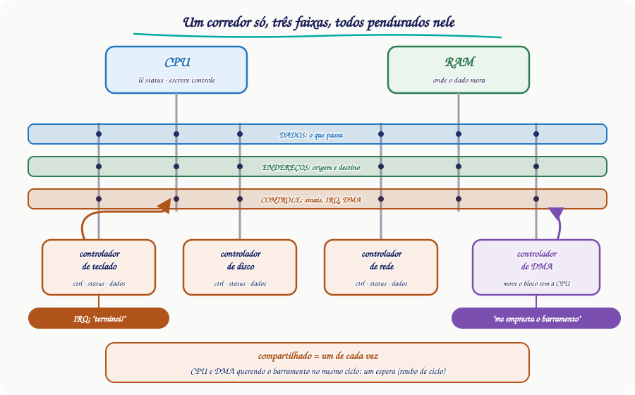
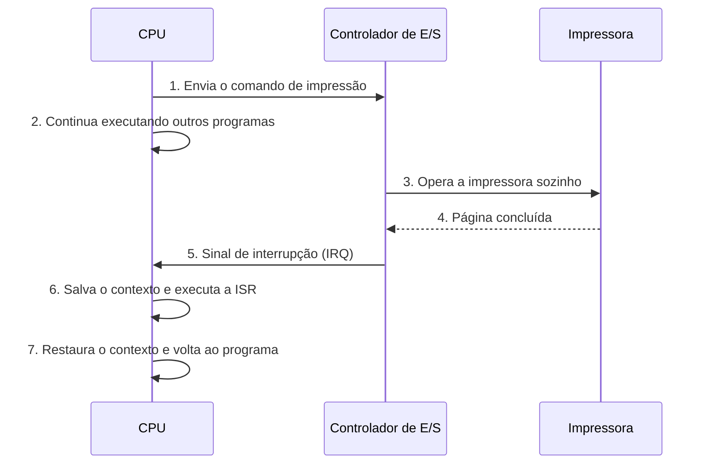
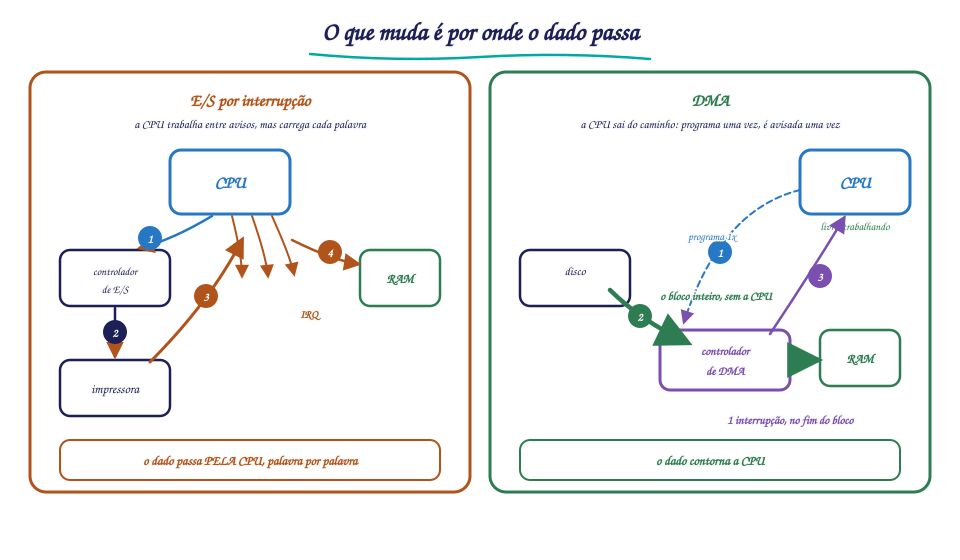
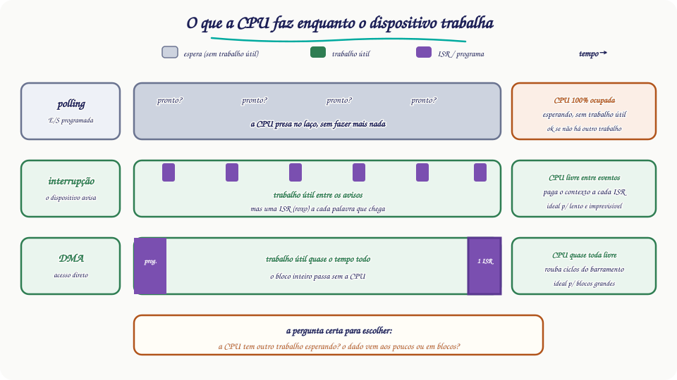

# 🖥️ Aula 09 — Mecanismos de Entrada e Saída (E/S)

**Disciplina:** {{CODIGO}} — Arquitetura e Organização de Computadores · Sistemas de Informação (curso 160) — Uniube 
**Professor:** Romualdo Mathias Filho · **romualdo.filho@uniube.br** 
**Data:** Quarta, 04/11/2026 · {{PERIODO}} · 📘 Teórica (75 min) 
**Tópicos:** O custo de esperar o dispositivo · Controlador de E/S e barramento · E/S programada (polling) · E/S por interrupção · Acesso direto à memória (DMA) 
**Página de referência:** [Plano de Ensino e Contrato](./Plano-de-Ensino-e-Contrato)

---

### Como os 75 minutos se dividem hoje

| Momento | Minutos |
|---|---|
| Entrada e caminho até aqui | 0–7 |
| Fundamentação: a CPU que espera o dispositivo | 7–15 |
| Controlador de E/S e barramento | 15–22 |
| E/S programada (polling) | 22–30 |
| E/S por interrupção | 30–40 |
| Acesso direto à memória (DMA) | 40–50 |
| Os três métodos lado a lado | 50–55 |
| Interativo: qual método atende cada dispositivo? | 55–63 |
| Resumo, reflexão e próxima aula | 63–70 |
| Folga | 70–75 |

---

<b>Nosso caminho até aqui</b>

Tente responder de cabeça. Depois abra e confira.

Na Aula 07, o que acontecia com o pipeline quando uma instrução precisava de um dado que ainda não estava pronto?

**Ele inseria uma bolha: um ciclo em que o estágio fica parado, sem trabalho útil.** Hoje a espera é muito maior. Em vez de um ciclo esperando a instrução da frente, a CPU (*Central Processing Unit*, o processador) pode passar milhões de ciclos esperando um disco ou uma tecla.

Na Aula 08, por que 8 núcleos não entregam 8 vezes mais velocidade?

**Porque a parte serial do programa não se divide: enquanto ela roda, os outros núcleos esperam.** Uma CPU parada esperando um dispositivo é o mesmo desperdício. Núcleo ocupado em esperar não é paralelismo útil, e é isso que os mecanismos de hoje evitam.

Ainda na Aula 08: dois núcleos guardam cópia do mesmo dado na cache L1. Quem garante que nenhum deles leia o valor velho?

**O hardware de coerência de cache, que invalida ou atualiza a cópia do outro a cada escrita.** Hoje aparece um terceiro escritor que não é núcleo: o controlador de DMA, que grava direto na memória principal.

> [!INFO] 🎯 O que você leva desta aula
> - Explicar **por que** a diferença de velocidade entre a CPU e um dispositivo obriga a existir um mecanismo de E/S, e quanto custa a CPU esperar.
> - Descrever o papel do **controlador de E/S** e dos **três barramentos** (dados, endereços e controle).
> - Distinguir **E/S programada (polling)**, **E/S por interrupção** e **DMA** pelo que a CPU faz enquanto o dispositivo trabalha e por onde o dado passa.
> - Escolher o método certo para um dispositivo (teclado, disco, placa de rede, sensor de microcontrolador) e justificar com dois critérios: volume de dados e trabalho livre da CPU.
>
> **📂 Recursos**
> - [Plano de Ensino e Contrato](./Plano-de-Ensino-e-Contrato) — calendário, notas, prazos e regras
> - Celular com acesso a **vevox.app** — para a votação do bloco interativo
> - Em casa: o **Gerenciador de Tarefas do Windows** (`Ctrl+Shift+Esc`, aba Desempenho), para ver a CPU quase parada durante a cópia de um arquivo grande

<aside class="au-antes">
<b class="au-nota-t">Antes de começar</b>

**E/S (Entrada e Saída)** — tudo o que entra no computador ou sai dele: teclado, mouse, disco, placa de rede, impressora. Cada dispositivo de E/S também é chamado de periférico.

**CPU (Central Processing Unit, Unidade Central de Processamento)** — o processador que você abriu nas Aulas 05 e 07: busca, decodifica e executa instruções.

**RAM (Random Access Memory, memória de acesso aleatório)** — a memória principal, onde ficam os programas e os dados em uso.

**SO (sistema operacional)** — o software que administra a máquina: decide qual programa usa a CPU, conversa com os dispositivos e atende os pedidos de E/S dos programas.

**Registrador de status** — a "luz de pronto" de um dispositivo. A CPU lê esse registrador para saber se o dispositivo terminou o que foi pedido.

**Contexto** — o que a CPU precisa guardar para voltar depois ao ponto exato em que parou: o contador de programa (PC, Program Counter), a palavra de estado (PSW, Program Status Word) e os registradores em uso.

</aside>

---

## 📌 1. A CPU é dezenas de milhões de vezes mais rápida que um dispositivo lento, e cada espera joga fora trabalho [Fundamentação ⏳ 8 min]

Tudo o que a CPU processa entra e sai por dispositivos que trabalham em outra escala de tempo. A impressora leva segundos por página. O disco leva uma eternidade, medida em ciclos. O teclado depende de um dedo humano.

Antes de abrir: sua CPU executa cerca de 3 bilhões de operações por segundo. Entre uma tecla e a próxima passa cerca de meio segundo. Quantas operações a CPU poderia ter feito nesse intervalo?

**Cerca de 1,5 bilhão.** Meio segundo vezes 3 bilhões por segundo. Se a CPU ficasse parada esperando a próxima tecla, jogaria fora 1,5 bilhão de operações a cada letra digitada. O teclado é o caso extremo, mas a tabela abaixo mostra que nem o disco escapa da comparação.

| Componente | O que se mede | Valor típico |
|---|---|---|
| CPU (*Central Processing Unit*) | frequência do clock | 3 a 5 GHz |
| Memória RAM (DDR5, *Double Data Rate 5*) | vazão | ~50 GB/s |
| SSD NVMe (*Non-Volatile Memory Express*) | vazão | ~7 GB/s |
| HD mecânico (*hard disk*, disco rígido) | vazão | ~150 MB/s |
| Teclado (digitação) | vazão | < 0,001 MB/s (menos de 1 KB/s) |

*Os números desta tabela são <b>ordens de grandeza ilustrativas</b> para a comparação, não a especificação de um modelo exato — o valor real varia com a geração da peça e o número de canais. O que importa é a escala da diferença, não o dígito.

A primeira linha mede outra coisa (o ritmo da CPU, não a quantidade de dados por segundo). Por isso a comparação justa é entre as linhas de vazão. A RAM entrega cerca de 50 GB/s e o teclado, menos de 1 KB/s: uma diferença de mais de 50 milhões de vezes, mais de sete ordens de grandeza.

O custo de esperar aparece em três lugares:

1. **Trabalho perdido.** Cada ciclo que a CPU gasta esperando é um ciclo em que nenhum programa avança.
2. **Programas travados.** Se a CPU fica presa esperando a impressora, a música para, o navegador congela e o antivírus não roda.
3. **Hardware caro ocioso.** Dobrar a velocidade da CPU não adianta se ela passa a maior parte do tempo esperando o disco.

> [!NOTE] 💬 É a Lei de Amdahl de novo, agora com o dispositivo
> Na Aula 08, a parte serial do programa punha um teto no ganho dos núcleos. Aqui, o tempo de espera pelo dispositivo faz o mesmo papel: se um programa passa 90% do tempo esperando o disco, uma CPU duas vezes mais rápida acelera só os 10% restantes. Na Aula 10 essa conta vira número.

*<b>vazão</b> (<i>throughput</i>): a quantidade de dados transferida por unidade de tempo (ex.: 50 GB/s). Difere do <b>clock</b>, que é o ritmo de trabalho da CPU (ex.: 3 GHz) — uma mede dados, a outra mede ciclos.

A pergunta que organiza o resto da aula: **o que a CPU faz enquanto o dispositivo trabalha?** Os três métodos de E/S são três respostas, cada uma tirando a CPU um pouco mais do caminho.

---

## 📌 2. A CPU nunca fala direto com o dispositivo: o controlador de E/S traduz, e o barramento leva [Teoria ⏳ 7 min]

Entre a CPU e cada dispositivo existe um intermediário, o **controlador de E/S**\* (também chamado de módulo de E/S). A CPU não conhece o protocolo da impressora nem o do disco. Ela escreve e lê alguns registradores do controlador, e o controlador conversa com o dispositivo na língua dele.

| Registrador do controlador | O que guarda | Quem escreve |
|---|---|---|
| **Controle** (comando) | o que fazer: ler, escrever, posicionar | a CPU |
| **Status** | se o dispositivo está ocupado, pronto ou com erro | o controlador |
| **Dados** | o byte ou a palavra que está entrando ou saindo | a CPU ou o controlador, conforme o sentido |

Todos esses componentes (CPU, RAM e controladores) se ligam por um **barramento**\*, um conjunto de fios compartilhado. Ele tem três grupos de linhas, cada um com uma função:

| Barramento | O que carrega | Analogia com uma carta |
|---|---|---|
| **Dados** | os bytes que estão sendo transferidos | o **conteúdo** da carta |
| **Endereços** | de onde o dado sai ou para onde vai (uma posição da RAM ou um registrador de controlador) | o **CEP** do destino |
| **Controle** | o tipo de operação (leitura ou escrita) e os sinais de coordenação, como o pedido de interrupção e o pedido de uso do barramento pelo DMA | o **tipo de serviço** dos Correios (carta simples, Sedex) |

<figure class="au-fig">

<figcaption class="au-legenda">Todo mundo fala pelo mesmo corredor. O barramento de controle carrega também os sinais de coordenação: é por ele que o dispositivo pede a atenção da CPU e que o DMA pede o barramento emprestado.</figcaption>
</figure>

> [!WARNING] ⚠️ Cuidado — compartilhado quer dizer "um de cada vez"
> O barramento é um meio compartilhado: num dado ciclo, só um componente coloca dado nele. Se a CPU e o controlador de DMA quiserem usá-lo ao mesmo tempo, um dos dois espera. Guarde isso: é a origem do "roubo de ciclo" do tópico 5.

> [!TIP] 💡 Dica — o controlador é um intérprete, o driver é o dicionário
> O controlador traduz o barramento para o dispositivo. O **driver\*** é o software do SO que sabe quais registradores daquele controlador ler e o que cada bit de status significa. Sem driver, o SO enxerga o chip, mas não sabe a língua dele.

*<b>controlador de E/S</b>: o chip intermediário entre o barramento e um dispositivo. Expõe à CPU registradores de controle, status e dados, e esconde dela o protocolo próprio do dispositivo. · <b>driver</b>: o trecho de software do sistema operacional que conhece um controlador específico — quais registradores ler e o que cada bit significa.

*<b>barramento</b>: o conjunto de fios compartilhado que liga CPU, memória e controladores. Divide-se em linhas de dados, de endereços e de controle.

---

## 📌 3. Na E/S programada a CPU pergunta em laço e não faz mais nada enquanto espera [Teoria ⏳ 8 min]

Na **E/S programada**, também chamada de **polling**\* ou espera ocupada (*busy-wait*), a CPU conduz a transferência inteira. Ela envia o comando e depois pergunta ao controlador, sem parar: "já terminou?".

1. A CPU escreve o comando (ler, escrever) no registrador de controle do controlador.
2. A CPU lê o registrador de status.
3. Se o status diz "ocupado", a CPU volta ao passo 2. É o laço de polling.
4. Quando o status diz "pronto", a CPU lê o dado do registrador de dados e o grava na memória (ou faz o contrário, numa saída).
5. Se ainda há dados a transferir, a CPU volta ao passo 1 para a próxima palavra.

Repare no passo 4: **cada palavra passa pela CPU**. Ela não só espera, ela também carrega o dado de um lado para o outro.

Antes de abrir: você aperta uma tecla enquanto o Spotify toca. Se o teclado fosse atendido por polling, o que aconteceria com a música?

**Ela pararia.** Enquanto a CPU está no laço lendo o status do teclado, ela não executa o Spotify, o navegador nem o antivírus. Um único dispositivo lento monopoliza o processador. É exatamente o que o próximo método corrige.

| Vantagem | Desvantagem |
|---|---|
| Simples de implementar em hardware e em software | A CPU gasta todo o tempo de espera dentro do laço |
| Previsível: nada acontece de surpresa, no meio do programa | Com vários programas ao mesmo tempo, um dispositivo lento monopoliza o processador |

> [!WARNING] ⚠️ Cuidado — polling não é sempre errado
> Num microcontrolador sem SO, como um Arduino que lê um sensor de temperatura a cada segundo, o polling é a escolha certa. Não há outro trabalho para a CPU fazer, e o laço é a solução mais simples e mais previsível. O erro é usar polling quando a CPU tem outro trabalho esperando por ela.

*<b>polling</b>: técnica em que a CPU consulta repetidamente o registrador de status de um dispositivo, em laço, até ele ficar pronto. A CPU fica ocupada, mas sem trabalho útil.

---

## 📌 4. Na E/S por interrupção o dispositivo avisa, e a CPU só para quando há o que fazer [Teoria ⏳ 10 min]

A **E/S por interrupção** inverte quem pergunta. A CPU envia o comando e vai fazer outra coisa. Quando o dispositivo fica pronto, o controlador manda um sinal elétrico, a **interrupção**\*, pela linha de pedido de interrupção (IRQ, Interrupt Request) do barramento de controle.

Nada disso exige um processador diferente. Como você viu na [[Aula 05 - Unidades de Processamento|Aula 05]], a CPU confere a linha de interrupção **ao final de cada instrução**, antes de buscar a próxima. O atendimento segue esta ordem:

1. A CPU termina a instrução que estava executando. Em geral, nenhuma instrução é cortada no meio — as exceções são instruções longas, como as de repetição de string do x86 (REP MOVS), que podem ser interrompidas entre iterações.
2. A CPU vê a linha de interrupção ativa.
3. O hardware salva o PC e a PSW, normalmente na pilha.
4. O PC recebe o endereço da ISR daquele dispositivo.
5. A ISR salva os registradores que vai usar, lê o dado do controlador e o grava na memória.
6. A ISR restaura os registradores, e o hardware restaura a PSW e o PC.
7. O programa interrompido continua do ponto exato onde parou, sem saber que foi interrompido.

**Exemplo:** você pressiona uma tecla. O controlador do teclado envia uma interrupção. A CPU estava rodando o navegador, o Spotify e o antivírus. Ela atende, guarda o caractere e volta ao que fazia, rápido o bastante para você não perceber.

> [!WARNING] ⚠️ Cuidado — interrupção não é de graça
> Cada interrupção custa o trabalho de **salvar o contexto, desviar para a ISR e restaurar o contexto** (os passos da lista acima). Com poucos eventos (teclas, cliques), esse custo é desprezível. Com muitos (cada palavra de um arquivo de 10 GB), a CPU passa mais tempo entrando e saindo de ISR do que fazendo trabalho útil. E repare: **dentro da ISR, o dado continua passando pela CPU**, palavra por palavra.

> [!NOTE] 💬 Salvar o contexto não é trocar de programa
> Atender uma interrupção guarda o contexto do programa interrompido para voltar a ele logo depois. Isso é diferente da troca de processo que o SO faz quando decide que outro programa vai usar a CPU (o escalonamento\*). Uma interrupção pode até levar o SO a trocar de processo depois, mas atender a interrupção, sozinho, não é essa troca.

*<b>ISR</b> (<i>Interrupt Service Routine</i>, rotina de tratamento de interrupção): o trecho de código que a CPU executa quando atende uma interrupção — salva o que vai usar, trata o evento e restaura. · <b>escalonamento</b>: a decisão do sistema operacional de qual programa usa a CPU em cada momento; é ele quem faz a troca de processo, não a interrupção.

| Vantagem | Desvantagem |
|---|---|
| A CPU fica livre para outros programas enquanto o dispositivo trabalha | Cada transferência ainda exige a CPU, que copia o dado e paga o custo do contexto |
| Ideal para dispositivos lentos e imprevisíveis (teclado, mouse) | Ineficiente para grandes volumes: uma interrupção por palavra afoga a CPU |

*<b>interrupção</b>: sinal enviado por um controlador à CPU, pela linha de pedido de interrupção (IRQ), avisando que um evento precisa de atenção. A CPU termina a instrução atual, salva o contexto, executa a ISR e depois retoma o programa.

---

## 📌 5. O DMA move o bloco inteiro sem a CPU no caminho e avisa uma vez só, no fim [Teoria ⏳ 10 min]

O **DMA** (Direct Memory Access, acesso direto à memória) resolve o que a interrupção ainda deixava: o dado passando pela CPU. Um chip dedicado, o **controlador de DMA**, transfere blocos inteiros entre o dispositivo e a RAM sem a CPU tocar em cada palavra.

1. A CPU programa o controlador de DMA com quatro informações: o sentido (leitura ou escrita), qual dispositivo, o endereço inicial na RAM e quantas palavras transferir.
2. A CPU volta a executar outros programas. A partir daqui ela está fora do caminho do dado.
3. Para cada palavra, o controlador de DMA pede o barramento pela linha de controle, recebe a permissão e move a palavra direto entre o dispositivo e a RAM.
4. Ao terminar o bloco inteiro, o controlador de DMA envia **uma única interrupção** à CPU.

<figure class="au-fig">

<figcaption class="au-legenda">A diferença entre os dois métodos está no caminho do dado. Na interrupção, cada palavra atravessa a CPU. No DMA, o dado contorna a CPU, que só programa o controlador no início e recebe um aviso no fim.</figcaption>
</figure>

O passo 3 é o **roubo de ciclo**\* (*cycle stealing*). Como o barramento é compartilhado (tópico 2), o controlador de DMA o toma emprestado por um ciclo a cada palavra, e a CPU fica suspensa nesse ciclo se precisar do barramento. Isso **não é uma interrupção**: a CPU não salva contexto nem executa ISR, só espera um ciclo de barramento. (Há um modo alternativo, a **rajada** (*burst*), em que o controlador segura o barramento pelo bloco inteiro: a CPU espera uma vez só, mas por mais ciclos seguidos.)

Antes de abrir: você copia um filme de 4 GB de um HD externo para o SSD. Por interrupção, quantas vezes a CPU é interrompida? E com DMA?

**Por interrupção, uma vez por unidade transferida:** bilhões de vezes se for byte a byte, milhões mesmo contando por setor do disco. **Com DMA, uma vez por bloco programado**, com a CPU livre no meio. É por isso que, durante uma cópia grande, o Gerenciador de Tarefas mostra o disco trabalhando muito e a CPU quase parada.

| Vantagem | Desvantagem |
|---|---|
| A CPU fica quase toda livre durante grandes transferências | Exige hardware extra: o controlador de DMA |
| O dado não passa pela CPU, nem palavra por palavra | Disputa o barramento com a CPU: a cada palavra, a CPU pode esperar um ciclo |

> [!WARNING] ⚠️ Cuidado — quem mantém a cache coerente com o DMA depende do sistema
> O controlador de DMA grava direto na memória principal. Se um núcleo tinha aquele endereço na cache L1, alguém precisa avisar que a cópia ficou velha — e **quem faz isso muda conforme a máquina**. No **x86** (o processador do seu notebook e dos servidores comuns) o **hardware** resolve sozinho: ele espia a escrita do DMA e invalida a cópia na cache, sem custo para o SO (a Intel ainda tem o DDIO, que grava o dado do dispositivo direto na cache L3). Em sistemas **sem DMA coerente**, como muitos ARM embarcados, a limpeza ou a invalidação da cache fica a cargo do **driver**, em software. É o problema de coerência da Aula 08, agora com um escritor que não é núcleo.

> [!NOTE] 💼 Pergunta de entrevista
> *"Placa de rede de 10 Gb/s: interrupção ou DMA?"*
>
> **Resposta esperada:** os dois, em papéis diferentes. O DMA move os pacotes da placa para a RAM sem a CPU tocar nos bytes. A interrupção avisa que um lote chegou. Quem responde "só interrupção" não percebeu que o gargalo não é a cópia em si — uma CPU atual copia 1,25 GB/s sem sufoco —, é pagar **uma interrupção e um acesso ao controlador por pacote**: a CPU morre entrando e saindo de ISR, não copiando.

---

## 📌 6. Os três métodos diferem em quem espera e por onde o dado passa [Teoria ⏳ 5 min]

<figure class="au-fig">

<figcaption class="au-legenda">De cima para baixo, a CPU sai do caminho. No polling ela gasta a espera inteira perguntando. Na interrupção ela trabalha, mas é chamada a cada palavra. No DMA ela é chamada uma vez, no fim do bloco.</figcaption>
</figure>

| | E/S programada (polling) | E/S por interrupção | DMA |
|---|---|---|---|
| **Quem espera** | a CPU, dentro do laço | o programa que pediu a E/S (o dispositivo trabalha); a CPU faz outra coisa | o controlador de DMA; a CPU faz outra coisa |
| **Por onde passa cada palavra** | pela CPU | pela CPU (dentro da ISR) | direto entre dispositivo e RAM |
| **Uso de CPU** | toda a espera | o custo do contexto a cada evento | programar no início e uma interrupção no fim |
| **Hardware extra** | nenhum além do controlador | linha de interrupção e controlador de interrupções\* | controlador de DMA\* |
| **Quando usar** | sem SO, um dispositivo só (sensor de microcontrolador) | dispositivo lento e imprevisível (teclado, mouse) | blocos grandes (disco, rede, vídeo) |

*<b>controlador de interrupções</b>: o chip que recebe as linhas de interrupção dos vários controladores e as entrega à CPU na ordem de prioridade certa, sem que uma se perca. · <b>controlador de DMA</b>: o chip dedicado que executa a transferência bloco a bloco entre dispositivo e RAM, no lugar da CPU.

> [!TIP] 💡 Dica — escolha pelo volume e pelo trabalho livre
> Pergunte duas coisas. **A CPU tem outro trabalho esperando?** Se não tem, polling basta. **O dado chega aos poucos ou em blocos?** Aos poucos e de surpresa, interrupção. Em blocos grandes, DMA.

---

<b>Interativo</b> · Qual método atende cada dispositivo? · Vevox · 8 min

Abra **vevox.app** e entre com o ID da sessão que está no projetor. Para cada cenário, vote em **Polling**, **Interrupção** ou **DMA**. Depois de cada votação, uma dupla defende a resposta com os dois critérios da aula: o trabalho livre da CPU e o volume de dados.

1. Você pressiona uma tecla no teclado.
2. Cópia de um filme de 4 GB do HD externo para o SSD.
3. Um Arduino, sem sistema operacional, lê um sensor de temperatura a cada segundo.
4. A placa de rede de um servidor recebe os pacotes de um pagamento Pix.

Discussão (abrir só depois da votação)

1. **Interrupção**: dado minúsculo e imprevisível; o polling travaria o resto do sistema.
2. **DMA**: bloco enorme; a CPU programa o controlador uma vez e recebe uma interrupção no fim.
3. **Polling**: não há outro trabalho para a CPU, e o laço é a solução mais simples e previsível.
4. **Os dois**: o DMA move os pacotes para a RAM; a interrupção avisa que um lote chegou.

<b>Plano B:</b> se a rede cair, os mesmos quatro cenários vão no quadro, com votação por dedos: um dedo é polling, dois é interrupção, três é DMA. Mesmo conteúdo, mesmo tempo.

---

<b>O que você viu hoje</b>

Tente explicar cada linha antes de reler a seção. É o esforço de lembrar que fixa, não a releitura.

| Conceito | Em uma frase |
| :--- | :--- |
| **O problema** | A CPU é dezenas de milhões de vezes mais rápida que um dispositivo lento; esperar parada joga fora trabalho e trava os outros programas. |
| **Controlador de E/S** | O chip entre o barramento e o dispositivo; a CPU fala com ele por registradores de controle, status e dados. |
| **Barramento** | Os fios compartilhados (dados, endereços e controle); só um componente fala por vez. |
| **E/S programada (polling)** | A CPU pergunta o status em laço e carrega cada palavra; não faz mais nada enquanto espera. |
| **E/S por interrupção** | O dispositivo avisa pela IRQ; a CPU trabalha entre avisos, mas paga o contexto e ainda carrega cada palavra. |
| **DMA** | O controlador de DMA move o bloco direto entre dispositivo e RAM e interrompe a CPU uma vez, no fim. |
| **Roubo de ciclo** | O DMA toma o barramento por um ciclo a cada palavra; a CPU espera esse ciclo sem salvar contexto. |

| Erro clássico | Correção |
| :--- | :--- |
| "Polling é sempre errado." | Num microcontrolador sem SO e com um dispositivo só, polling é a escolha mais simples e previsível. |
| "Com interrupção, a CPU não participa da transferência." | Participa: dentro da ISR, a CPU copia cada palavra. Quem tira a CPU do caminho do dado é o DMA. |
| "Atender interrupção é trocar de processo." | Atender interrupção salva o contexto para voltar ao mesmo programa; trocar de processo é decisão do escalonador do SO. |
| "Roubo de ciclo é uma interrupção." | No roubo de ciclo a CPU só espera um ciclo de barramento; não salva contexto nem executa ISR. |
| "O DMA não usa a CPU, então não afeta a CPU." | O DMA disputa o barramento com ela e escreve na RAM sem avisar a cache — e quem mantém a coerência depende do sistema: no x86, o hardware; em sistemas sem DMA coerente, o driver. |
| "O barramento de controle só diz se é leitura ou escrita." | Ele também carrega os sinais de coordenação: pedido de interrupção e pedido de barramento do DMA. |

<b>🎧 Podcast da Aula 09 — Entrada e Saída</b>

O áudio chega em breve.

<b>Para pensar até a próxima aula</b>

No fim da aula você leu sobre o NAPI: sob carga alta, com a fila de pacotes cheia, o Linux <b>desliga a interrupção</b> da placa de rede e volta a fazer <b>polling</b> por um instante.

Se a interrupção existe justamente para tirar a CPU do laço, <b>quando ser interrompido passa a custar mais que perguntar?</b> O que muda na conta quando a fila está sempre cheia? Traga sua hipótese — na próxima aula, essa espera vira número.

<i>Não há resposta nesta página de propósito.</i>

<b>Referências desta aula</b>

- STALLINGS, W. **Arquitetura e Organização de Computadores: projetando com foco em desempenho.** São Paulo: Pearson. cap. 7 (Entrada/Saída), página não conferida; cap. 3 (barramentos e interconexão), página não conferida — edição e ano a confirmar no acervo — controlador de E/S, E/S programada, E/S por interrupção, DMA e roubo de ciclo (tópicos 2 a 6); barramentos de dados, endereços e controle (tópico 2).
- TANENBAUM, A. S.; AUSTIN, T. **Organização Estruturada de Computadores.** 6. ed. São Paulo: Pearson, 2013. capítulo de entrada/saída e barramentos, página não conferida — barramentos e chips controladores de dispositivos.
- PATTERSON, D. A.; HENNESSY, J. L. **Organização e Projeto de Computadores: A Interface Hardware/Software.** 5. ed. Rio de Janeiro: Elsevier, 2014. capítulo de entrada/saída e desempenho, página não conferida — impacto da E/S no desempenho do sistema.

### Para ir além

- [Input/Output Organization — GeeksforGeeks (em inglês)](https://www.geeksforgeeks.org/input-output-organization-in-computer-architecture/) — artigo com diagramas dos três métodos de E/S, incluindo o roubo de ciclo. Complementa as figuras da aula; não substitui o capítulo 7 do Stallings.
- Em casa: abra o Gerenciador de Tarefas (`Ctrl+Shift+Esc`), aba Desempenho, e copie um arquivo grande entre dois discos. Observe a CPU enquanto o disco trabalha: é o DMA em ação.
- Quando a interrupção vira o problema: num servidor que recebe muitos pacotes de rede por segundo, uma interrupção por pacote afoga a CPU no custo de **entrar e sair da rotina de tratamento** (salvar e restaurar o contexto), uma vez por pacote. Sob carga alta, o Linux desliga a interrupção da placa de rede e volta a fazer polling por um instante, porque com a fila cheia perguntar sai mais barato que ser interrompido. O mecanismo se chama NAPI (*New API*); procure por esse nome.

<b>Na próxima aula</b>

Hoje você viu que a CPU mais rápida do mundo continua esperando o disco, e que a saída é tirá-la do caminho. Na Aula 10 essa espera vira número: <b>medidas de desempenho</b>, latência, vazão e a Lei de Amdahl calculada dizem quanto vale acelerar cada parte, e quando não vale nada.

