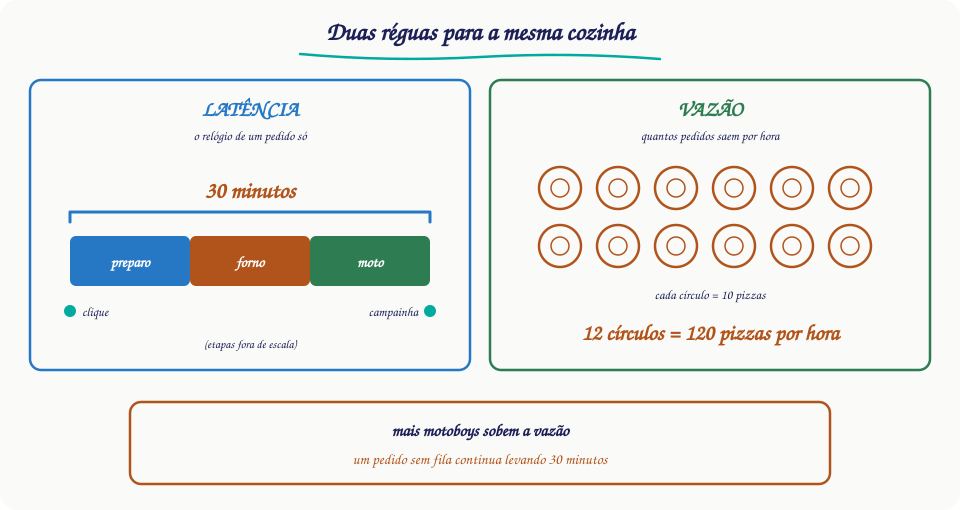
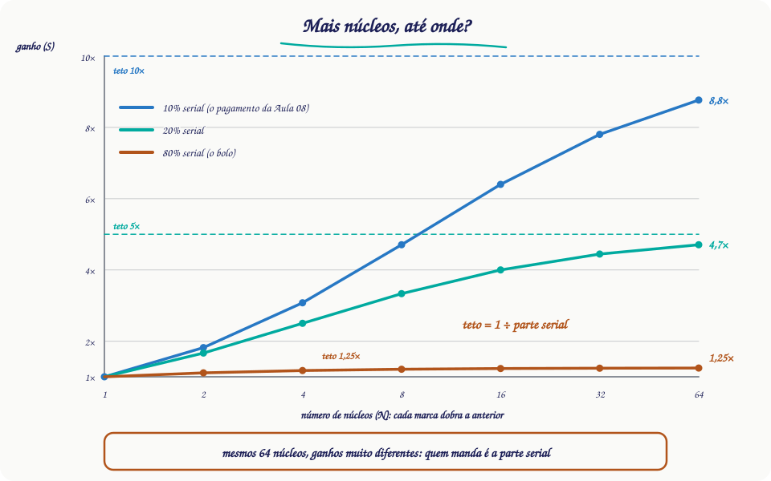

# 🖥️ Aula 10 — Medidas de Desempenho: Latência, Vazão e Lei de Amdahl

**Disciplina:** {{CODIGO}} — Arquitetura e Organização de Computadores · Sistemas de Informação (curso 160) — Uniube 
**Professor:** Romualdo Mathias Filho · **romualdo.filho@uniube.br** 
**Data:** Quarta, 11/11/2026 · {{PERIODO}} · 📘 Teórica (75 min) 
**Tópicos:** Latência e vazão: as duas réguas · Tempo de CPU (*Central Processing Unit*, o processador) em três fatores, e por que a propaganda engana · Lei de Amdahl: o teto do ganho e onde gastar o esforço 
**Página da disciplina:** [todas as aulas](./)

---

### Como os 75 minutos se dividem hoje

| Momento | Minutos |
|---|---|
| Entrada | 0–5 |
| Caminho até aqui: três perguntas de cabeça | 5–12 |
| 1. Latência e vazão: as duas réguas | 12–20 |
| 2. O tempo de CPU em três fatores, e por que a propaganda engana | 20–40 |
| 3. A Lei de Amdahl, e onde gastar o esforço | 40–55 |
| Momento interativo: qual é o ganho? | 55–65 |
| Resumo, reflexão e próxima aula | 65–70 |
| Folga | 70–75 |

---

<b>Nosso caminho até aqui</b>

Tente responder de cabeça. Depois abra e confira.

No polling, o que a CPU faz enquanto o dispositivo trabalha?

**Espera em laço, perguntando "já terminou?".** Nesse tempo ela não faz trabalho útil, e essa espera entra inteira no tempo que o usuário sente. Hoje esse tempo ganha nome: latência, a primeira régua da aula.

Qual parte de um programa não se divide entre núcleos?

**A parte serial:** o trecho que só um núcleo pode executar por vez, como a trava do saldo na Aula 08. Guarde essa parte. Hoje você vai medir quanto ela custa.

No pipeline, o que melhora: o tempo de cada instrução ou quantas terminam por ciclo?

**Quantas terminam por ciclo.** Cada instrução continua gastando 5 ciclos do começo ao fim; com a linha cheia, sai 1 por ciclo. Hoje esses dois lados ganham nome e viram as duas réguas do desempenho.

> [!INFO] 🎯 O que você leva desta aula
> - Distinguir **latência** (o tempo de uma tarefa) de **vazão** (quantas tarefas por tempo) e dizer qual das duas cada pessoa sente.
> - Calcular o **tempo de CPU** com os três fatores: número de instruções, ciclos por instrução e duração do ciclo.
> - Explicar por que a frequência em **GHz** (gigahertz, bilhões de ciclos por segundo) e os **MIPS** (milhões de instruções por segundo) da caixa do produto não dizem qual processador é mais rápido.
> - Usar a **Lei de Amdahl** para prever o teto de ganho de uma melhoria que acelera só uma parte do trabalho, e decidir **onde** gastar o esforço.
>
> **📂 Recursos**
> - [Página da disciplina](./) — a lista de todas as aulas
> - [Amdahl's Law Calculator (Omni)](https://www.omnicalculator.com/other/amdahls-law) — calculadora em inglês, para conferir as contas do momento interativo
> - Papel e caneta (ou a calculadora do celular) — as contas do momento interativo são feitas à mão primeiro

<aside class="au-antes">
<b class="au-nota-t">Antes de começar</b>

**Instrução** — um comando que a CPU executa, como somar dois números ou ler um dado da memória (Aulas 05 e 07).

**Ciclo de clock** — o "tique" do relógio da CPU. Cada passo de uma instrução leva um ou mais ciclos (Aulas 05 e 06).

**Frequência** — quantos ciclos de clock acontecem por segundo. 3 GHz são 3 bilhões de ciclos por segundo (Aula 02).

**ms e ns** — o milissegundo (ms) é um milésimo de segundo; o nanossegundo (ns) é um bilionésimo de segundo. A 3 GHz, cada ciclo dura 1 ÷ 3.000.000.000 s, cerca de 0,33 ns.

**Pipeline** — a linha de montagem da CPU: várias instruções avançam ao mesmo tempo, cada uma num estágio (Aulas 04 e 07).

**Núcleo e parte serial** — um núcleo é um processador completo dentro do chip. A parte serial de um programa é o trecho que não dá para dividir entre núcleos (Aula 08).

</aside>

---

## 📌 1. Latência é o tempo de um pedido e vazão é quantos pedidos saem por hora: as duas medem "rápido" de jeitos diferentes [Fundamentação ⏳ 8 min]

"Esse computador é rápido" pode querer dizer duas coisas. Uma pizzaria mostra a diferença: o cliente com fome e o dono olhando o caixa fazem perguntas diferentes sobre a mesma cozinha.

Antes de abrir: num dia calmo, sem fila, a sua pizza chega em 30 minutos. No sábado cheio, a pizzaria passa de 1 para 10 motoboys. Para um pedido que não pega fila, em quanto tempo chega a SUA pizza?

**Nos mesmos 30 minutos.** O preparo, o forno e o trajeto não mudaram. Os motoboys a mais fazem sair **mais pizzas por hora**, desde que a entrega fosse o gargalo (se a cozinha não der conta, pizza a mais não sai); só encurtariam a sua espera se ela incluísse ficar na fila esperando um motoboy livre.

São duas medidas diferentes. O tempo da sua pizza é a **latência**\*. As pizzas por hora são a **vazão**\*.

<figure class="au-fig">

<figcaption class="au-legenda">Duas réguas para a mesma cozinha. A da esquerda mede <b>um</b> pedido, do clique à campainha. A da direita conta <b>quantos</b> pedidos saem por hora. Mais motoboys mexem na da direita; um pedido sem fila continua na da esquerda.</figcaption>
</figure>

| | **Latência** | **Vazão** |
|---|---|---|
| **O que mede** | o tempo de **uma** tarefa, do começo ao fim | quantas tarefas o sistema **inteiro** conclui por unidade de tempo |
| **Quem pergunta** | o cliente, com fome | o dono da pizzaria, olhando o caixa |
| **Unidade** | tempo: segundos, ms, ns, ciclos | tarefas por tempo: pizzas por hora, requisições por segundo, GB/s (gigabytes por segundo) |
| **Na pizza** | do clique no aplicativo até a campainha: **30 minutos** | a cozinha despacha **120 pizzas por hora** (exemplo) |
| **No computador** | a tela do aplicativo do banco abrir depois da senha: digamos **100 ms** | quantas requisições por segundo um servidor atende |

Você já usou as duas palavras, só não tinham o nome:

- **Aula 06:** a latência da memória é o tempo entre pedir um dado e recebê-lo, medida em ciclos. Em ordem de grandeza, cerca de 4 ciclos se o dado está na cache L1 (a mais próxima da CPU) e cerca de 100 se está só na RAM (*Random Access Memory*, a memória principal). Esse 100 é a conta redonda da Aula 06; nos processadores de hoje, a ida à RAM pode passar de 200 ciclos.
- **Aula 07:** no pipeline, cada instrução continua gastando 5 ciclos (latência), mas sai 1 por ciclo (vazão).

| | Sem pipeline | Com pipeline de 5 estágios |
|---|---|---|
| **Latência de uma instrução** | 5 ciclos | 5 ciclos |
| **5 instruções terminam em** | 25 ciclos | 9 ciclos |
| **Vazão com a linha cheia** | 1 instrução a cada 5 ciclos | 1 instrução por ciclo |

As duas réguas não se convertem uma na outra. Um sistema pode ir bem numa e mal na outra: o dono da pizzaria fica contente com o caixa enquanto o cliente reclama do relógio.

> [!NOTE] 💼 Pergunta de entrevista
> *"O time dobrou a quantidade de servidores e o usuário continua reclamando que o aplicativo é lento. O que aconteceu?"*
>
> **Resposta esperada:** dobrar servidores dobra a **vazão**, isto é, quantos pedidos por segundo cabem. O usuário sente a **latência** do pedido dele. Se a reclamação era fila, servidor a mais ajuda. Se era o tempo de uma requisição sem fila, não ajuda: é preciso encurtar o caminho dela, não abrir mais caminhos.

<b>*latência</b> — o tempo que uma tarefa leva do começo ao fim. Mede-se em unidades de tempo: segundos, milissegundos, ciclos.

<b>*vazão</b> (<i>throughput</i>) — quantas tarefas o sistema conclui por unidade de tempo: pizzas por hora, requisições por segundo, gigabytes por segundo.

---

## 📌 2. O tempo de CPU é o produto de três fatores, e nenhum deles sozinho conta a história [Teoria ⏳ 20 min]

### 2.1 O tempo de CPU nasce de três fatores que se multiplicam

Para um programa, a medida que importa é o **tempo de CPU**\*: quanto tempo a CPU trabalha para ele. O tempo sai de três perguntas simples:

1. **Quantas instruções** o programa executa? É o **IC**\* (*Instruction Count*, contagem de instruções).
2. **Quantos ciclos** cada instrução gasta, em média? É o **CPI**\* (*Cycles Per Instruction*, ciclos por instrução). Instruções diferentes gastam ciclos diferentes, por isso o CPI é uma média.
3. **Quanto dura** cada ciclo? É o **Tclock**, o período do clock: o inverso da frequência. A 3 GHz, cerca de 0,33 ns.

Multiplicando as três respostas:

$$\text{Tempo de CPU} = IC \times CPI \times T_{clock} = \frac{IC \times CPI}{\text{frequência}}$$

Pense em **escrever um livro à mão**. O IC são as palavras do livro. O CPI são as batidas de caneta por palavra. O Tclock é a velocidade da mão. Para escrever mais depressa há só três caminhos, e cada um é de uma profissão:

1. **Menos palavras (baixar o IC):** dizer a mesma coisa com menos texto. É trabalho do programador e do compilador.
2. **Menos batidas por palavra (baixar o CPI):** letras mais simples de traçar. É trabalho do engenheiro de hardware, com pipeline e cache.
3. **Mão mais rápida (baixar o Tclock):** subir a frequência. É trabalho do silício e do clock.

<figure class="au-fig">

<figcaption class="au-legenda">Quatro caixas, uma multiplicação. Cada fator tem um dono, e melhorar um deles sem olhar os outros dois pode não mudar o tempo. As duas barras de baixo são a aposta logo adiante.</figcaption>
</figure>

<b>A conta</b> · exemplo com números inventados

# programa com 6 bilhões de instruções, CPI médio 2, CPU de 3 GHz
ciclos  = 6 bilhões × 2                  # = 12 bilhões de ciclos
tempo   = 12 bilhões ÷ 3 bilhões por segundo   # = 4 segundos

Antes de abrir: um programador encurtou o código de 100 para 50 instruções, mas as novas instruções gastam 4 ciclos cada, em vez de 2. O clock é o mesmo. O programa ficou mais rápido?

**Ficou exatamente igual.**

- **Antes:** 100 instruções × 2 ciclos = 200 ciclos
- **Depois:** 50 instruções × 4 ciclos = 200 ciclos

Metade das palavras, o dobro de batidas por palavra: o livro leva o mesmo tempo. Não adianta melhorar um lado da conta sem olhar o outro.

O CPI é uma média porque cada tipo de instrução gasta um número de ciclos. A Aula 04 já avisava: no CISC (*Complex Instruction Set Computer*) o CPI é alto e variável, no RISC (*Reduced Instruction Set Computer*) fica perto de 1. Um exemplo, com números inventados:

| Tipo de instrução | Fração do programa | Ciclos de cada uma | Contribuição ao CPI |
|---|---|---|---|
| aritméticas (somar, comparar) | 50% | 1 | 0,5 × 1 = 0,5 |
| acesso à memória (`load`, `store`) | 30% | 4 | 0,3 × 4 = 1,2 |
| desvios (`if`, laços) | 20% | 2 | 0,2 × 2 = 0,4 |
| **CPI médio** | **100%** | | **2,1** |

A linha da memória pesa 1,2 dos 2,1 ciclos, mais da metade do CPI. Guarde esse número: ele volta no item 3.2.

> [!TIP] 💡 Dica — meça antes de trocar a máquina
> No Linux, o comando `perf stat ./programa` mostra quantas instruções e quantos ciclos o programa gastou, e calcula o IPC (*Instructions Per Cycle*, instruções por ciclo), que é o inverso do CPI. IPC baixo, ou seja, CPI alto, costuma indicar um programa que passa o tempo esperando a memória. Nesse caso, mais GHz ajuda pouco.

<b>*tempo de CPU</b> — o tempo que a CPU trabalha para o seu programa. Não conta a espera pelo disco nem o tempo em que ela atende outros programas.

<b>*IC</b> (<i>Instruction Count</i>) — quantas instruções de máquina o programa executa até terminar. · <b>*CPI</b> (<i>Cycles Per Instruction</i>) — a média de ciclos de clock que cada instrução gasta.

---

### 2.2 GHz e MIPS enganam porque cada um mede só um dos três fatores

A caixa do produto e a propaganda gostam de um número só. Cada número destaca um fator e esconde os outros dois. A analogia do livro mostra como isso engana.

A **Ana** e o **Bruno** receberam a mesma redação para escrever:

| | **Ana** | **Bruno** |
|---|---|---|
| **Estilo** | palavras simples, curtas e repetitivas | vocabulário rico, direto e denso |
| **Taxa de escrita** | **100 palavras por minuto** | **30 palavras por minuto** |
| **Palavras para a mesma ideia** | 300 | 90 |
| **Tempo até terminar** | 300 ÷ 100 = **3 minutos** | 90 ÷ 30 = **3 minutos** |

Pela taxa de escrita, a Ana parece mais de três vezes melhor. Os dois terminam no mesmo minuto. O **MIPS**\* engana pelo mesmo motivo: processadores diferentes precisam de quantidades diferentes de instruções para a mesma tarefa. Com a frequência em milhões de ciclos por segundo, a conta é MIPS = frequência ÷ CPI.

Dois processadores, a mesma tarefa. Imagine que o Y usa instruções mais simples e por isso precisa de mais delas:

| | Processador X | Processador Y |
|---|---|---|
| **Frequência** | 3 GHz (3.000 milhões de ciclos por segundo) | 4 GHz (4.000 milhões de ciclos por segundo) |
| **CPI médio** | 2 | 2 |
| **Instruções para a tarefa (IC)** | 12 bilhões | 16 bilhões |
| **MIPS** (frequência ÷ CPI) | 3.000 ÷ 2 = **1.500** | 4.000 ÷ 2 = **2.000** |

Antes de abrir: o Y tem mais GHz e mais MIPS que o X. Qual dos dois termina a tarefa primeiro?

**Terminam juntos.**

- **X:** 12 bilhões × 2 ÷ 3 bilhões por segundo = 24 ÷ 3 = **8 segundos**
- **Y:** 16 bilhões × 2 ÷ 4 bilhões por segundo = 32 ÷ 4 = **8 segundos**

O Y ganha no GHz e no MIPS e empata no que importa: o tempo. O que o clock e o MIPS escondem é quantas instruções a tarefa pede.

> [!WARNING] ⚠️ Cuidado — GHz na caixa não é velocidade
> Comparar dois chips pelo clock só vale entre chips da mesma família (mesma microarquitetura) rodando o mesmo programa compilado. Fora disso, um chip de 3 GHz vence um de 4 GHz se executar menos instruções ou gastar menos ciclos em cada uma.

> [!NOTE] 💬 MIPS tem dois significados
> Na Aula 07 você viu a arquitetura MIPS, um conjunto de instruções usado nos exemplos. Aqui, MIPS é outra coisa: a unidade "milhões de instruções por segundo". É coincidência de sigla.

Como comparar de verdade? Rodando programas reais e medindo o **tempo**. Conjuntos prontos desses programas se chamam **benchmarks**\*. A SPEC (*Standard Performance Evaluation Corporation*) é uma organização que publica benchmarks usados para comparar processadores.

<b>*MIPS</b> — milhões de instruções por segundo. Conta quantas instruções a máquina executa por segundo, mas não pergunta quantas instruções a tarefa exige.

<b>*benchmark</b> — conjunto de programas escolhidos para representar o uso real e usados para comparar máquinas pelo tempo que cada uma leva.

---

## 📌 3. A Lei de Amdahl limita o ganho pela parte que não acelera, e diz onde vale gastar o esforço [Teoria ⏳ 15 min]

### 3.1 O forno do bolo prova

Você compra um aspirador de pó superveloz. Até onde isso acelera a faxina da casa inteira? A resposta tem nome: a **Lei de Amdahl**\*. O ganho do todo é limitado pela parte que não melhora.

Fazer um bolo de chocolate com amigos leva **50 minutos**, em duas etapas:

1. **Bater a massa:** 10 minutos. Pode ser dividida: cinco amigos batendo juntos terminam mais rápido.
2. **Assar:** 40 minutos. Não pode ser dividida: o bolo precisa daquele tempo de calor. Dez pessoas sentadas na frente do forno não assam nada mais rápido.

Antes de abrir: você chama mil amigos para bater a massa, cada um com uma fatia igual. Em quanto tempo o bolo fica pronto?

**Em quase 40 minutos.** A massa cai de 10 minutos para 0,6 segundo (10 min ÷ 1.000), mas o forno continua com os 40 minutos inteiros. O bolo passa de 50 para cerca de 40 minutos: um **ganho**\* de 1,25 vez, e nenhum amigo a mais muda isso.

Dois números descrevem a melhoria: **F**, a fração do tempo **original** que ela alcança (a massa: 10 ÷ 50 = 0,2), e **s**, quantas vezes essa fração fica mais rápida (aqui, o número de amigos).

| Amigos batendo a massa (s) | Massa | Forno | Bolo pronto em | Ganho do bolo |
|---|---|---|---|---|
| 1 | 10 min | 40 min | 50 min | 1× |
| 2 | 5 min | 40 min | 45 min | 1,11× |
| 5 | 2 min | 40 min | 42 min | 1,19× |
| 10 | 1 min | 40 min | 41 min | 1,22× |
| mil, ou infinitos | quase 0 | 40 min | quase 40 min | quase 1,25× |

Em fórmula, com S o ganho do todo:

$$S = \frac{1}{(1 - F) + \dfrac{F}{s}} \qquad\Longrightarrow\qquad S_{max} = \frac{1}{1 - F}$$

A segunda fórmula é o teto: o que sobra quando s cresce sem limite. No bolo, F = 0,2 e o teto é 1 ÷ 0,8 = 1,25. É a fórmula da Aula 08, com F no lugar de P e s no lugar de N. A diferença é que agora s pode ser qualquer melhoria, não só núcleos.

> [!WARNING] ⚠️ Cuidado — F é a fração do tempo antes da melhoria, e o gargalo muda de lugar
> Antes de acelerar a massa, o forno era 80% do tempo (40 de 50 minutos). Com 5 amigos o bolo leva 42 minutos, e o forno passa a ser 40 ÷ 42, cerca de 95% do tempo. Quem melhora uma parte faz a outra pesar mais: o **gargalo**\* muda de lugar. Depois de cada melhoria, meça de novo antes de decidir a próxima.

<figure class="au-fig">

<figcaption class="au-legenda">Cada curva é um programa diferente. Quanto maior a parte serial, mais cedo a curva achata. O pagamento da Aula 08 (10% serial) ainda precisa de 64 núcleos para chegar perto de 9 vezes. O bolo, com 80% serial, mal sai do chão.</figcaption>
</figure>

Lendo o gráfico: com 20% de parte serial, 8 núcleos já entregam 3,3 vezes dos 5 possíveis, e 64 núcleos entregam 4,7. Oito vezes mais núcleos para um ganho só 1,4 vez maior. Dinheiro de hardware com retorno cada vez menor.

<b>*Lei de Amdahl</b> — descrita por G. M. Amdahl em 1967 (artigo nas referências). Diz que o ganho do todo é limitado pela fração do trabalho que a melhoria não alcança. Supõe que o tamanho do trabalho não muda.

<b>*ganho</b> (<i>speedup</i>, aceleração) — quantas vezes mais rápido ficou o trabalho: tempo antigo ÷ tempo novo. Ganho de 2× quer dizer metade do tempo.

<b>*gargalo</b> — a parte do trabalho que mais pesa no tempo total e, por isso, limita o ganho.

---

### 3.2 Na hora de investir, encolher a fatia grande vence zerar a fatia pequena

Um exercício de decisão, do dia a dia de quem cuida do desempenho de um aplicativo de entregas. A tela inicial leva **10 segundos** para abrir no celular:

| Etapa | O que faz | Tempo | Fatia |
|---|---|---|---|
| **Imagens** | baixar as fotos dos restaurantes pela internet | 8 s | 80% |
| **Desenho** | desenhar os botões na tela do celular | 2 s | 20% |

Antes de abrir: a Opção 1 zera o desenho (ele passa a levar 0 s). A Opção 2 faz as imagens baixarem 4 vezes mais rápido. Qual abre a tela mais cedo?

**A Opção 2, e não é por pouco.**

| | O que muda | A tela abre em | Ganho do todo |
|---|---|---|---|
| **Opção 1** — zerar o desenho | 2 s caem para **0 s** | 8 + 0 = **8 s** | 10 ÷ 8 = **1,25×** |
| **Opção 2** — imagens 4× mais rápidas | 8 s caem para **2 s** | 2 + 2 = **4 s** | 10 ÷ 4 = **2,5×** |

Zerar a fatia pequena rendeu 1,25×. Encolher a fatia grande rendeu 2,5×. A fórmula avisa: zerar uma etapa de 20% nunca passa de 1 ÷ 0,8 = 1,25. Acelerar 4 vezes uma etapa de 80% dá 1 ÷ (0,2 + 0,8 ÷ 4) = 2,5.

A mesma lógica vale dentro da CPU. No CPI de 2,1 do tópico 2, a memória pesava 1,2: cerca de 57% do CPI (4 em cada 7). Uma cache melhor que leve os acessos à memória de 4 para 2 ciclos é exatamente o que o momento interativo vai calcular.

> [!TIP] 💡 Dica — onde gastar o dinheiro
> A Lei de Amdahl é um guia de compra. Antes de comprar um computador caro para casa ou para a empresa, meça onde está a **espera de verdade**. Se você passa o dia esperando a internet baixar arquivos, um processador 10 vezes mais rápido rende pouco; o mesmo dinheiro numa conexão melhor rende mais.

---

<b>Momento interativo</b> · Qual é o ganho? · em duplas · 10 min

Em duplas, resolvam cada caso **à mão**, com a fórmula da Lei de Amdahl, e anotem o ganho **antes** de abrir a resposta. Depois, confiram na calculadora (link em 📂 Recursos). Ela está em inglês: usa **p** para a fração que melhora (o nosso F) e **s** para quantas vezes essa fração fica mais rápida.

1. **O relatório do mês.** Um relatório leva 60 minutos: 40 lendo dados do HD (*hard disk*, disco rígido) e 20 calculando. Trocam o HD por um SSD (*Solid State Drive*, unidade de estado sólido) que lê 4 vezes mais rápido. Em quanto tempo o relatório fica pronto? Qual é o ganho? E qual seria o teto, mesmo com um disco infinitamente rápido?
2. **O pagamento da Aula 08.** Com 10% de parte serial, quantos núcleos são necessários para chegar a 5 vezes? É possível chegar a 10 vezes?
3. **A cache melhor.** No CPI de 2,1 do tópico 2, os acessos à memória passam de 4 para 2 ciclos. O IC e o clock não mudam. Qual é o novo CPI e qual é o ganho? Confira com a fórmula de Amdahl: quanto vale o F?
4. **Se sobrar tempo.** Você pode melhorar 30% do tempo de um programa em 10 vezes, ou 70% do tempo em 2 vezes. Qual das duas vale mais?

Respostas (abrir só depois de a dupla anotar)

1. A leitura cai de 40 para 10 minutos (40 ÷ 4). O relatório leva 10 + 20 = **30 minutos**, e o ganho é 60 ÷ 30 = **2×**. Pela fórmula: F = 40 ÷ 60 = 2/3, e S = 1 ÷ (1/3 + (2/3) ÷ 4) = 1 ÷ 0,5 = 2. O teto é 1 ÷ (1 − 2/3) = **3×**, com o relatório em 20 minutos, o tempo do cálculo.
2. Para S = 5: 0,1 + 0,9 ÷ N = 0,2, logo N = **9 núcleos**. Para 10×: 0,1 + 0,9 ÷ N teria de ser 0,1, o que exige 0,9 ÷ N = 0, e isso só acontece com N infinito. **Não é possível**; com 64 núcleos o ganho é 8,8×.
3. Novo CPI = 0,5 + 0,3 × 2 + 0,4 = 0,5 + 0,6 + 0,4 = **1,5**. Ganho = 2,1 ÷ 1,5 = **1,4×**. Pela fórmula: F = 1,2 ÷ 2,1 = 4/7, s = 2, e S = 1 ÷ (3/7 + (4/7) ÷ 2) = 1 ÷ (5/7) = 7/5 = 1,4. Bate.
4. Melhorar 30% em 10×: S = 1 ÷ (0,7 + 0,3 ÷ 10) = 1 ÷ 0,73 = **1,37×**. Melhorar 70% em 2×: S = 1 ÷ (0,3 + 0,7 ÷ 2) = 1 ÷ 0,65 = **1,54×**. Vale mais a melhoria **menor** na fatia **maior**.

<b>Plano B:</b> se a rede cair, nada muda: a conta é à mão e a calculadora só confere. Os quatro casos vão no quadro e a dupla resolve com a fórmula S = 1 ÷ ((1 − F) + F ÷ s). Mesmo conteúdo, mesmo tempo.

---

<b>O que você viu hoje</b>

Tente explicar cada linha antes de reler a seção. É o esforço de lembrar que fixa, não a releitura.

| Conceito | Em uma frase |
| :--- | :--- |
| **Latência** | O tempo de uma tarefa, do começo ao fim; é o que quem espera sente. |
| **Vazão** | Quantas tarefas o sistema conclui por unidade de tempo; é o que o dono do sistema conta. |
| **Tempo de CPU** | IC × CPI × Tclock, ou IC × CPI ÷ frequência. |
| **IC, CPI e Tclock** | Quantas instruções, quantos ciclos por instrução em média e quanto dura um ciclo; cada fator é de uma profissão. |
| **MIPS** | Milhões de instruções por segundo (frequência ÷ CPI); conta instruções sem olhar quantas a tarefa exige. |
| **Benchmark** | Conjunto de programas reais usado para comparar máquinas pelo tempo que cada uma leva. |
| **Lei de Amdahl** | Ganho do todo = 1 ÷ ((1 − F) + F ÷ s); o teto é 1 ÷ (1 − F). |
| **Gargalo** | A parte que mais pesa no tempo total; muda de lugar a cada melhoria. |

| Erro clássico | Correção |
| :--- | :--- |
| "Mais servidores deixam a minha tarefa mais rápida." | Sobem a vazão. A latência de uma tarefa sem fila não muda. |
| "Mais GHz, computador mais rápido." | O tempo é IC × CPI ÷ frequência. Se o chip executa mais instruções ou gasta mais ciclos em cada uma, perde o ganho do clock. |
| "MIPS maior quer dizer mais rápido." | O MIPS não olha quantas instruções a tarefa pede. Dois chips podem empatar em tempo com MIPS bem diferentes. |
| "Cortar as instruções pela metade corta o tempo pela metade." | Só se o CPI e o clock ficarem iguais. 100 × 2 e 50 × 4 gastam os mesmos 200 ciclos. |
| "Acelerar uma parte 10 vezes acelera o todo 10 vezes." | O ganho do todo nunca passa de 1 ÷ (1 − F). Acelerar 10 vezes uma parte que é 25% do tempo dá só 1,29×. |
| "O F é a fração do tempo depois da melhoria." | O F é a fração do tempo **antes**. Depois, a parte que sobrou pesa mais: o forno era 80% de 50 minutos e vira 95% de 42. |
| "Zerar a etapa pequena vale mais que encolher a grande." | Zerar uma etapa de 20% dá no máximo 1,25×. Encolher 4 vezes uma etapa de 80% dá 2,5×. |

<b>🎧 Podcast da Aula 10 — Medidas de Desempenho</b>

O áudio chega em breve — gerado por IA a partir do material da disciplina.

<b>Para pensar até a próxima aula</b>

Pela Lei de Amdahl, com 10% de parte serial nem mil núcleos passam de 10 vezes. Mesmo assim, servidores e supercomputadores continuam ganhando núcleos, ano após ano.

O que muda quando, em vez de tentar assar <b>o mesmo bolo</b> mais depressa, você usa os amigos para fazer <b>dez bolos</b> no mesmo tempo? A parte do forno continua sendo 80% do trabalho? Traga sua hipótese.

<i>Não há resposta nesta página de propósito.</i>

<b>Referências desta aula</b>

- AMDAHL, G. M. Validity of the single processor approach to achieving large scale computing capabilities. In: SPRING JOINT COMPUTER CONFERENCE, 1967, Atlantic City. **AFIPS Conference Proceedings**, v. 30. Reston: AFIPS Press, 1967. p. 483–485 — o artigo original de três páginas de onde saiu a lei (tópico 3).
- SMITH, J. E. Characterizing computer performance with a single number. **Communications of the ACM**, v. 31, n. 10, out. 1988. p. 1202–1206 — por que o tempo de execução é a medida que vale, e por que uma taxa usada como nota única, como o MIPS e o MFLOPS, engana (tópico 2).
- STANDARD PERFORMANCE EVALUATION CORPORATION. **SPEC CPU® 2017.** Disponível em: https://www.spec.org/cpu2017/. Acesso em: 8 nov. 2026. página de apresentação do benchmark — as suítes SPECspeed comparam o tempo de uma tarefa (latência) e as SPECrate medem o trabalho por unidade de tempo (vazão); a mesma página anuncia que o SPEC CPU 2026 sucede a versão 2017 (tópicos 1 e 2).
- THE LINUX MAN-PAGES PROJECT. **perf-stat(1): Linux manual page.** Disponível em: https://man7.org/linux/man-pages/man1/perf-stat.1.html. Acesso em: 8 nov. 2026. seções NAME e DESCRIPTION — o comando que roda um programa e conta ciclos e instruções, usado na dica do tópico 2.

### Para ir além

- [Amdahl's law in Computer Organization — GeeksforGeeks (em inglês)](https://www.geeksforgeeks.org/computer-organization-architecture/computer-organization-amdahls-law-and-its-proof/) — artigo sobre a lei de Amdahl, com a dedução da fórmula. Complementa a figura do tópico 3.
- [Amdahl's Law Calculator (Omni)](https://www.omnicalculator.com/other/amdahls-law) — a calculadora do momento interativo: mude a fração e o fator e veja o teto de ganho na hora.
- Em casa: abra o Gerenciador de Tarefas (`Ctrl+Shift+Esc`), aba Desempenho, CPU. Ele mostra a velocidade da sua máquina em GHz. Calcule o período do ciclo (1 ÷ frequência) e compare com os 0,33 ns da aula.
- Depois de pensar na reflexão, procure por **Lei de Gustafson**.

<b>Na próxima aula</b>

Hoje você mediu para onde o tempo vai e viu que a parte que não acelera manda no ganho. Na Aula 11 entra uma camada nova entre o programa e o hardware: o <b>hipervisor</b>, que faz uma máquina fingir ser várias. A primeira pergunta que você vai fazer a ele é a de hoje: quanto de latência e de vazão essa camada custa?

